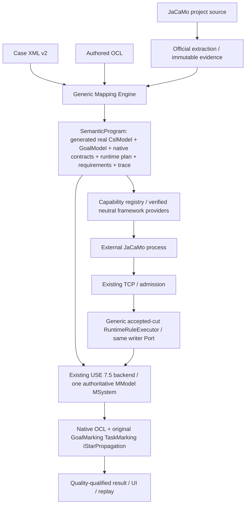

> **Active scope 2026-10-26:** implementation tiếp theo theo [`../../../plan.md`](../../../plan.md) tại root repository (`use/plan.md`). Nội dung G00–G13 dưới đây là evidence lịch sử của generated-model profile, không phải acceptance cho authored five-input mode.

# Generic declarative JaCaMo mapping — implementation checklist

Audit cập nhật: 2026-10-24 (Asia/Bangkok). Repo duy nhất được sửa: `D:/_CODE_BANK/Project_/08_Thesis/use`. Branch `main`; checkpoint đã push `34b29a428ae8ae9f9070eef4e57a4219cd93f97a` (local HEAD = origin/main tại push; sửa audit sau checkpoint chưa commit). Không tạo branch/worktree/reset/clean unknown files. Checkpoint cũ đã push; yêu cầu hiện tại KHÔNG commit/push. Final DoD của declarative profile đã đạt bằng executable evidence; xem Final acceptance closeout. Historical integrity giữ ngoại lệ LOST đã được user cho phép. `jacamo`/`use4Goal` read-only. Đọc `agent.md` trước implementation. Plan này thay hoàn toàn scope Auction-specific trước; executable receipts cũ được giữ tại `verification/auction/`, không diễn giải chúng thành generic acceptance.

## 1. Current architecture

Production consumer hiện có hai đường explicit. `JACAMO_DECLARATIVE_XML`: facade ImportSelection → MappingInputs → GenericMappingEngine → CslRuleExecutor/IStarRuleExecutor (generate source trong memory, original frontends/validators) → real CslModel/GoalModel → XmlNativePreparation → existing native USE pipeline → XmlRuntimeStateMapping/XmlTaskCheckpoints/OccurrenceGoalModelExpander → RuntimeEngineSessionOwner → original Use4GoalRuntimeSessionAdapter. `casePlan == null` trong đường này; legacy AUCTION_OBSERVED_V1 vẫn được giữ riêng. Chỉ một authoritative live MSystem; frozen before/after views không phải runtime thứ hai. Native OCL và original marking/propagation được reuse.

Audit hiện tại đã xác minh:
- Neutral static engine không mở `.csl/.istar/.drawio`; oracle absence/corruption tests và XML-driven Case B static + M0/native OCL pass. Legacy Auction readers vẫn đọc frozen oracle bundle để bảo toàn historical contract; optional containsKey guards không phải test-only và đã được gỡ, không tắt legacy validation để gọi đó là genericization.
- BridgeJcmDerivation kiểm đúng một `BRIDGE_PLATFORM_INSERTION/1.0` ngay trước dấu đóng root; XML vẫn pin canonical hash, official snapshot phải match derived hash. Canonical và actual staged bytes cùng frozen trong inputs/complement/replay; replay xác minh lại recipe mà không đọc path cũ. Port/path/format/duplicate/domain-source tamper bị reject. Không dùng broad regex normalization hay bỏ checksum gate.
- Consumer facade/UI selector/replay 3.3/3.4 đã nối generic program. Actual launcher headless TCP import/resync pass; actual InteractiveGui ghi MODEL_READY/bridge LIVE. Receipts ở `verification/generic-mapping/audit-live-import/` và `audit-gui-import/`; scope chỉ import/resync, bridge PARTIAL, không phải all-six-task live verification.
- Production bootstrap đã nối: facade publish ObservationRequestPlan/1.1 theo frozen XML/epoch → launcher activation trước startAgs → ProductionObservationSession registries → actual CArtAgO/Jason/shared NPL/source clock → existing TCP. Generic không bật legacy Auction flags. `G11-drain-terminal-live.log` BUILD SUCCESS: unchanged Auction MAS, eight requirements, six native Task POST, original TaskMarking/propagation, external PID, same MSystem. Cold installed/UI/replay và full host archive qualification đã PASS tại G13-frozen-generic-live/; tách rõ source gate với final archive proof.
- InstalledAuctionMain hiện có explicit JACAMO_DECLARATIVE_XML branch bên cạnh strict legacy branch. GenericPackagedPluginIT cold Auction + Case B pass; semantic-acceptance.py có thêm --require-generic (không thay default/legacy gate). Full frozen-archive qualification và strict aggregate G13 đã PASS; evidence mới tại G13-final-acceptance.json, không dùng old receipts thay generic acceptance.
- GoalMarking/TaskMarking/IStarMarking/IStarPropagation source hashes khớp sourceSha256/targetSha256 ORIGINAL_COPY trong provenance manifest; không sửa engine. ObservationQualityGate giữ unavailable/error/undefined là null/qualified state; test Case B PARTIAL không sinh FAIL.
- Final unfiltered `G13-final-npl-subscription-clean-verify.log` BUILD SUCCESS1323 unit/167 integration/0 failures/errors/skips, legacy198 PASS, full archive generic2/2+legacy4/4+Counter/deployment4 checks PASS. Strict G13-final-acceptance.json: ACCEPTED_WITH_EXCEPTIONS (chỉ protected Desktop report LOST đã được user cho phép), generic.status=PASS, auction.status=PASS; all22 A-V matrix gates. Các log bị ngắt/fail trước đó là baseline, không được tính pass.

Existing Q08 acceptance là baseline legacy, không phải generic DoD. Source/TCP/admission/sequence/watermark/run/generation/checkpoints/quality/native ownership được giữ. Inventory dưới đây mô tả legacy components còn phải giữ/isolate; neutral replacement đã implement được ghi trong G01–G10, không hiểu bảng này là current generic call chain.

### Class disposition (source audited by role and direct call chain)
| Current classes | Classification | Treatment |
|---|---|---|
| AuctionMappingSpecification/XmlLoader/SelectorResult, CaseBundle/JcmDerivation | Genericizable bounded syntax/IO/trace + legacy catalog/derivation policy | Extract neutral primitives; old dialect wrapper preserves historical readers |
| AuctionSourceSelector | Generic regex/XPath/condition machinery + fixed official-model crosschecks | Share bounded primitive; XML-driven explicit evidence assertions replace capture-name inference |
| AuctionCslRuleExecutor | Legacy oracle contract + shared M1 instruction implementation | Neutral interpreter has no oracle IO; retain strict legacy checks |
| AuctionStaticMappingAdapter/BindingPlan/IStarSourceAdapter | Auction semantic selection/model-source/alias ownership | Replace with generated graph + neutral program plan; metadata adapter/diagram compare test/compat only |
| AuctionUseModelAdapter/ObserverUseBinding/OclSpecificationLoader | Genericizable schema helpers, pure OCL parser/compiler, with typed case interfaces | Extract/reuse; native engine unchanged |
| AuctionOclBindings/TaskOclBindings/TaskCheckpoints | Interface/predicate/checkpoint infrastructure + fixed source/alias/slot contracts | Declarative bindings; keep exact native pre-state/actor/correlation |
| AuctionRuntimeRules/RuntimeStateMapping/ArtifactBindingResolver/LifecycleMapping | M0 interpreter, identity joins/removal + Auction types/goals/field rules | Generic IR executor with same Port/savepoint; joins/origins/policies in XML |
| AuctionMonitorProjection/ObligationProjection/ObservationCut/SourceClock | Accepted-cut/time/history infrastructure + goal/field aggregation | Reuse cut fold/clock validation; explicit XML observer transforms |
| AuctionSchemeObservationDecoder/ObligationDecoder/StepObservationDecoder/TaskDemand | Framework evidence decoding + pinned case binding policies | Provider decoders neutral; XML supplies source topology/boundaries/demand joins |
| AuctionOccurrenceBindingAdapter/GoalInstanceExpander | Player/context identity + per-committed-bid quantification | Neutral occurrence plan, explicit ALL policy; original recurrence untouched |
| AuctionEvidenceEncoder | Case trace labels and actual API/hash evidence | Neutral plan trace/provenance; no authority in labels |
| producer AuctionArtifactStateProbe | Framework lock/field/coherent read + fixed class/field allowlist | Verified bounded neutral request provider; unavailable when denied |
| producer AuctionStagingInstrumentation/AuctionStepObservation | Jason exact AST/callback mechanics + fixed six sites/source hash/variables | Request-defined steps; never mutate source/domain outcome |
| producer AuctionSchemeObservation/AuctionClockObservation | Public MOISE/NPL/system clock capability + fixed case goals/admin | Neutral provider registered by typed requirements; source clock policy unchanged |
| Auction* tests/controlled fixture/source/oracles/old receipts | Test/oracle/provenance | Preserve semantic oracle bytes; new profile acceptance explicit |

## 2. Target architecture

Generic means Java interprets explicit case XML, not inferred universal JaCaMo semantics. `.csl/.istar/.drawio` are test-only oracles; authored `.ocl` stays production. No scripts/reflection arbitrary class names/remote mutation in mapping language. Supported instruction subset closed/versioned; unsupported rejected, unavailable provider yields INCOMPLETE/UNSUPPORTED, never false.

## 3. Gap analysis

| Area | Current | Target | Status |
|---|---|---|---|
| Inputs | Legacy22-asset bundle retained; neutral frozen input reader verified | Project + XML + OCL, hashes in spec/evidence | VERIFIED (new reader/program; facade wired) |
| CSL | Generic interpreter/original frontend parity verified; old route retained | Generic instructions, test-only parity | VERIFIED (generic path connected) |
| iStar | XML generator/original frontend parity verified; old route retained | XML graph generation via original frontend | VERIFIED (generic path connected) |
| M0 | Neutral XML cut interpreter và generic facade branch verified | XML plan drives joins/origins/keys/write/remove | VERIFIED (generic path connected) |
| Providers | Run-owned pre-start production bootstrap and actual TCP receipts verified | Typed requirement registry, verified neutral providers | VERIFIED (source bootstrap + cold installed/full-ZIP actual live) |
| OCL | Shared native parser/compiler/schema, XML operation/Goal/Task binders verified | Generic authored-clause/predicate bindings | VERIFIED (generic path connected) |
| State/transport/core | Proven infrastructure | Reuse unchanged ownership and semantics | EXISTING |
| Replay/UI/package | Declarative source import và frozen full-ZIP live/UI/replay đều pass | Explicit generic profile/version/frozen spec; old compatibility | VERIFIED (final clean/full-ZIP/strict generic+legacy aggregate PASS) |

Dependency order: `G00 → G01 → G02/G03 → G04 → G05/G06 → G07 → G08 → G09 → G10 → G11 → G12 → G13`. G02/G03 and G05/G06 are logically independent; no delegation/new worktree. Focused tests immediately with each task, not deferred to G13. Final clean/package/live once after stable source, unless an actual failure requires rerun. No fabricated blocker from scope size; record actual API/data blockers with evidence.

## 4. Generic mapping specification tasks

- [x] **TASK-G00 — Audit và freeze boundary**
  - Goal: Audit và freeze boundary.
  - Files/classes: 31 classes mapping/auction; 5 producer Auction classes; SemanticProgram; DefaultJaCaMoFacade; CodeGroundedNativePipeline; RuntimeEngineSessionOwner; CanonicalReplaySupport.
  - Change: Inventory dưới đây; giữ Q08 receipts/22 oracle pins, không mang log cũ vào plan. Không rebuild baseline đã có chỉ để audit.
  - Focused test: Đối chiếu Q08 acceptance/hash và current call chain; branch/status.
  - Acceptance criterion: Phân loại semantic logic/provider/infrastructure và dependency được ghi chính xác.
  - Dependency: None.
  - Status: EXISTING / VERIFIED — current source/callers and old Q08 receipt inspected: ACCEPTED_WITH_EXCEPTIONS,1138 unit/165 integration. Branch main and HEAD unchanged. Audit inventory above; generic runtime not yet implemented.

## G01 — Versioned neutral XML specification và bounded IO

- [x] **TASK-G01 — Versioned neutral XML specification và bounded IO**
  - Goal: Versioned neutral XML specification và bounded IO.
  - Files/classes: mapping/xml/MappingSpecification, MappingXmlReader; shared fragment selector.
  - Change: Dialect urn:use:jacamo-mapping:2; immutable located nodes, IDs/refs, closed instruction/attribute vocabulary, capacities, XXE off, source paths/hash, OCL pin; không đọc oracle. Extract bounded parser/selector primitive cho legacy wrapper reuse.
  - Focused test: Malformed/XXE/path traversal/unknown rule/ref/duplicate/size/source drift; shared legacy selector tests.
  - Acceptance criterion: Spec có diagnostics file/line/rule; unsupported không fallback; immutable source+spec ownership.
  - Dependency: G00.
  - Status: EXISTING / VERIFIED — G01-focused.log passes20/20 (new XML4/input2 + legacy XML6/selector8), zero failure/error/skip. G01-contract-baseline.log reproduces2 negative failures before validation. Shared bounded SourceSelectors reused by legacy wrapper; official admission unchanged. XML v2 runtime/observer sections intentionally accept no executable child yet; later tasks extend closed vocabulary with actual handlers, never silently ignore unknown instructions.

## 5. Generic static rule engine tasks

- [x] **TASK-G02 — Generic CSL M1 rule interpreter**
  - Goal: Generic CSL M1 rule interpreter.
  - Files/classes: mapping/xml/CslRuleExecutor, SourceSelectors; legacy AuctionCslRuleExecutor wrapper.
  - Change: Extract existing XML instruction semantics, bỏ oracle IO khỏi core; classifier/attribute/containment/invariant/data conversions từ XML/captures. Keep original compiler/validator/backend.
  - Focused test: Auction generated fingerprint == original oracle; change XML changes model; no oracle present; Case B distinct identifiers.
  - Acceptance criterion: Real CslModel generated; no Auction names/IDs/counts in interpreter; trace selector→rule→declaration.
  - Dependency: G01.
  - Status: EXISTING / VERIFIED — G02-focused.log21/21 pass: new CSL3/input2/XML4 + legacy CSL4/selector8. Real Auction CslModel matches frozen fingerprint478ce44d…2bc720 without any oracle/manifest in input directory; corrupt added oracles ignored; XML rename changes actual Entity; inventory Case B uses same interpreter/source capture. Legacy adapter delegates all M1 instructions to core and retains only old ownership/oracle policy. New XML is a static migration draft; runtime/observer/binding requirements remain G06–G11, not falsely complete.

## 6. Generic iStar generation tasks

- [x] **TASK-G03 — Generic iStar graph generation**
  - Goal: Generic iStar graph generation.
  - Files/classes: mapping/xml/IStarRuleExecutor; original IStarFrontend/OwnedGoalModel.
  - Change: XML actors/roles/agent/goals/tasks/resources, typed refinements/dependencies/associations, predicates, metadata/aliases; original compiler/model/validator with explicit versioned policy. No file/graph-builder fallback.
  - Focused test: Auction structural/model parity oracle; Case B AND/OR/dependency/resource; changed XML graph; missing endpoint/wrong owner/unsupported SEQUENCE fail.
  - Acceptance criterion: Real GoalModel generated exclusively from source selectors+XML. Task predicates explicit; active goal not satisfied.
  - Dependency: G01.
  - Status: EXISTING / VERIFIED — G03-focused.log13/13 pass (iStar4/CSL3/XML4/input2); G03-baseline.log records unimplemented executor errors. Original frontend builds graph from XML/captures; Auction fingerprint equals unchanged oracle without oracle IO, strict profile retains3 validator errors, Case B exercises original AND/OR/dependency/resource. Invalid endpoint/wrong owner/SEQUENCE and strict-profile incompatibility reject; description retained as trace metadata, never ignored semantic edges.

## G04 — Immutable Generic Mapping Program và SemanticProgram integration

- [x] **TASK-G04 — Immutable Generic Mapping Program và SemanticProgram integration**
  - Goal: Immutable Generic Mapping Program và SemanticProgram integration.
  - Files/classes: SemanticProgram; MappingRuleSet; TraceComplement; mapping/xml/GenericMappingEngine, GenericBindingPlan.
  - Change: Freeze JaCaMo source/XML/authored OCL and generated models; neutral plan interface instead of Auction-typed casePlan; source hash/derivation trace; explicit profile ownership; engine cannot import case package.
  - Focused test: Program ownership/hash/tamper; oracle removal/alteration; Case B no case Java; legacy JSON unchanged.
  - Acceptance criterion: Same public SemanticProgram contains real generated models + declarative plans/requirements, no oracle input.
  - Dependency: G02,G03.
  - Status: EXISTING / VERIFIED — G04-regression.log26/26 pass (new program3, XML/static13, legacy canonical7/Auction3). G04-baseline.log reproduces missing program executor. Generic plan owns frozen source/XML/OCL and real models; exact normalized-source queries/static classifier coverage, actor/self/derived bindings, complete source complement, deep frozen evidence and ownership guards. Native publication explicitly rejects this new plan until G05 preparation exists; no implicit legacy/Auction fallback. Staged-JCM receipt and complete Auction runtime spec remain G10/G11; current production old paths preserved.

## 8. Generic OCL binding tasks

- [x] **TASK-G05 — Generic native schema và authored OCL binding**
  - Goal: Generic native schema và authored OCL binding.
  - Files/classes: AuctionUseModelAdapter/AuctionObserverUseBinding/AuctionOclSpecificationLoader/AuctionOclBindings → neutral shared implementations; CodeGroundedNativePipeline.
  - Change: Reuse host parser/compiler/Boolean gates; XML supplies context/self/task/operation signature, aliases, result/@pre/variables and observer schema/origins. Pure parser/compiler extracted; no bodies hardcoded; compile candidate fully before publish.
  - Focused test: Native invariant/pre/post/@pre/result/undefined/invalid; exact operation overload/actor; observer helper not CSL Entity; Case B and old profiles.
  - Acceptance criterion: Compiled native OCL on single candidate MModel; contexts/bindings all validated, missing not false.
  - Dependency: G04.
  - Status: EXISTING / VERIFIED — G05-regression.log36/36 pass; extraction11/11 and native8/8 also pass. Shared AuthoredOclSpecificationLoader/CslScopeModelAdapter/ObserverSchema replace duplicate parser/compiler/schema machinery; legacy adapters keep old policy/annotations. XmlNativePreparation compiles the same generated model on existing native pipeline, exact producer-backed operation signatures, authored clause inventory/context, original Goal/Task slots and XML typed variables/observer tuples. Tests prove native @pre/arguments/result/same system, invalid/missing binding rejection and PARTIAL→SKIPPED, not false. Observer aggregation/runtime identity and history remain G07–G09; no live generic claim. Baseline G05 records missing neutral API, not a runtime success.

## 9. Capability registry/provider tasks

- [x] **TASK-G06 — Capability registry and declarative provider requests**
  - Goal: Capability registry and declarative provider requests.
  - Files/classes: bridge contract; producer JaCaMoBridgePlatform/CartagoSnapshotSource/BridgeAgArch; neutral provider registry.
  - Change: XML capability requirements compile to bounded typed requests with class/provider/hash/field/type/step AST boundaries/source clock/OS IDs. Replace AuctionArtifactStateProbe/StagingInstrumentation/SchemeObservation mapping constants with XML request data. Registry only permits verified framework implementations; no arbitrary reflection/script/network control.
  - Focused test: Missing/unsupported provider→qualified unavailable; wrong hash/type/access/lock/AST→reject; no source side effects; passive concurrency; provider lifecycle.
  - Acceptance criterion: No if-case-name/FQCN fixed Auction/goal IDs in provider; precise coherence/provenance, bounded access on pinned APIs.
  - Dependency: G04.
  - Status: EXISTING / VERIFIED — G06-requests.log8/8 producer tests +3/3 plugin tests; G06-scheme.log4/4 producer +4/4 plugin, G06-step-observer-fixed.log3/3 producer +14/14 plugin; field/clock/legacy receipts retained. XML requests include immutable source pins, exact plan triggers/partitions, capture variables/typed inputs and explicit artifact fields/properties. Curated registry returns unavailable for unsupported/denied requests and closes ownership. Jason public AST/listener/ActionExec identity + deferred cleanup shared with legacy adapters; legacy marker spelling preserved. Neutral MOISE captures two Counter schemes, actual source-definition equality, public history and explicit internal-time unavailability; no case goal/freeze/admin-credit logic in new provider. Runtime bootstrap/TCP publication of new receipts is explicitly G11; observer aggregation G08, not falsely claimed here.

## 7. Generic runtime rule engine tasks

- [x] **TASK-G07 — Generic accepted-cut runtime executor**
  - Goal: Generic accepted-cut runtime executor.
  - Files/classes: CaseRuntimeMapping; AuctionRuntimeRules/RuntimeStateMapping/ArtifactBindingResolver/LifecycleMapping → XML runtime IR/executor.
  - Change: Compile XML M0 facts/joins/key tuple/origins/converters/upsert/link/assign/remove/requirements; neutral source evidence providers. Same native writer Port and savepoint; no six-rule/R06/type-name switch. Missing required input yields INCOMPLETE before atomic write.
  - Focused test: Two instances, no object from configured goals, immutable ID, bad types, partial/stale/gap, same-name recreation/removal, savepoint rollback, Case B.
  - Acceptance criterion: Runtime M0 dispatch determined by XML; same authoritative MSystem; identity/incarnation/generation and coverage preserved.
  - Dependency: G05,G06.
  - Status: EXISTING / VERIFIED — G07-acceptance.log: contract1/1 + plugin30/30, zero failures/errors/skips; G07-shared-regression.log18/18 retained old Auction native transactions/projection/M0. XML controls bounded fact/field-cut/removal datasets, joins/expansion/typed columns/identity/converters/native M0 writes and COMPLETE-only logical role retirement. Tests exercise actual CArtAgO provider and MOISE GroupBoard, exact frozen definitions, provider/request/class/UUID/workspace/cut validation, two objects, immutable ID, missing→undefined, physical disposal/new UUID, role re-enactment, source aliases, same native MSystem/savepoint rollback, projector stale/gap/resync/restart and event deltas. Baselines reproduce missing handlers/admission and quality bug; field receipt event fold replaces current receipts, never merges old callback authority. No provider classes loaded in consumer decoder, no oracle or case constants in new interpreter. G11 still owns real producer bootstrap/TCP publication; Auction specification migration G10 and live acceptance G13 remain unchecked. Observer/step/norm semantics are G08/G09, not claimed by this M0 gate.

## G08 — Generic observer and temporal/norm projection

- [x] **TASK-G08 — Generic observer and temporal/norm projection**
  - Goal: Generic observer and temporal/norm projection.
  - Files/classes: AuctionMonitorProjection/ObligationProjection/SourceClock/SchemeObservationDecoder/ObligationDecoder/TaskDemand.
  - Change: XML observer view expressions/evidence joins/latches/frozen sets/time origin/deadline/admin rules. Reuse NPL/functional decoders and source evidence; no bid/decide/admin field strings in executor. Explicit observed prefix/clock invalidation.
  - Focused test: Actual vs done vs admin, late commitment, deadline/terminal, unavailable internal times, no false repair, replay deterministic source clock.
  - Acceptance criterion: Observer schema outside CSL, same native state; raw evidence not invented; no receiver time as source time.
  - Dependency: G07.
  - Status: EXISTING / VERIFIED — G08-clock.log producer7/7 + plugin5/5; G08-clock-dataset.log producer2/2 + plugin10/10; G08-continuation.log17/17. Original clock mechanics extracted into neutral SourceClock, legacy record/API/error spelling delegates; XML clock dataset requires explicit NPL binary pin. Native projector retains the same rollback-owned epoch proof index across partial resync, refuses re-anchor/high-water regression/history loss. Actual provider samples/native Integer range/deadline exact-boundary/replay and old compatibility tested. G08-invalidation.log12/12 fixes reproduced known→undefined event publication (stateVersion must advance; no cached verification); G08-observer.log13/13 proves XML class-view projection/current slots, explicit observed-prefix latch and first-accepted-qualified freeze on same native state/savepoint. Freeze is not claimed to be first internal framework transition; source history and Auction XML must supply that evidence separately. G08-observer-lifecycle.log17/17 covers type ERROR→undefined (never false), XML-only class rename, same-system restart without carried latch/freeze. G08-transition-birth.log5/5: neutral MOISE cut v2.1 retains actual transition memberships/done and public capture order; actual init property publication precedes artifactCreated (javap confirms init commits observables before Workspace creation callback). The callback explicitly establishes a post-init creation baseline/birthSequence; pre-birth samples remain trace and cannot supply internal transition timestamps. An invalid unquoted hyphen name remains INCOMPLETE in a negative fixture. G08-scheme-decoder.log5/5 and G08-scheme-dataset.log7/7 verify neutral v2.1 consumer against actual public/CArtAgO identities, source definition/binaries/cut/request/run, post-birth transition chain, frozen source memberships and administrative effects; no admin-absence Boolean is inferred from state history. G08-first-by.log15/15 adds declared unique earliest capture within complete source prefixes and keeps unclassified partial board populations unknown. G08-selection-identity.log16/16 verifies fractional/ambiguous/unknown earliest selection and multiple observer records per physical subject with exact declared keys. G08-npl.log producer3/3 + plugin3/3 and G08-npl-shared.log7/7 exercise actual NPL activation/deadline/terminal/modality/replay and shared legacy obligation decoder; neutral NplLifecycleCut owns framework time/identity checks, legacy wrapper retains Auction selection. G08-npl-registry.log6/6 reuses NplBoardSnapshotSource under a curated capability with explicit run/generation/revision, binary pin, official registry/workspace discovery and listener close; no new norm engine/thread/transport. G08-npl-dataset.log6/6 joins actual selected NPL activations to physical CArtAgO board/workspace UUIDs and source cuts; population remains PARTIAL and missing evidence never supplies false. G08-reference.log8/8 proves XML prior-project reference resolution by exact physical subject plus key tuple, native associations/current missing disconnect, explicit retained binding conflict and same-state savepoint rollback. G08-npl-history.log9/9 integrates the original NormLifecycleMonitor on native rollback-owned metadata: actual ACTIVE→UNFULFILLED, source subscription/sequence/first-terminal consistency, sticky ERROR→undefined on contradiction, exact savepoint restoration. G08-value-set.log15/15 verifies declarative typed collection selection/distinct values with explicit per-collection coverage; unknown candidate/filter/type never becomes an empty known set. The baseline also reproduced a retained-reference conflict recovering silently; conflict is now sticky within the epoch. G08-relative.log17/17 verifies XML relativeTime against validated immutable source-cut clock context, no receiver clock/negative/fractional/overflow repair. G08-operation-provider.log5/5 proves curated class-hash-pinned public CArtAgO STARTED/terminal history with two actual performers, non-improving success distinct from failure, late attach incomplete, close cleanup. G08-operation-decoder.log9/9 verifies consumer request/epoch/current physical provider/UUID/public operation descriptor/signature/invocation predecessor/performer identity, explicit unknown current player and XML selected successful-player sets; publication remains G11. G08-npl-event.log2/2 fixes a reproduced event-only defect: raw NPL callbacks now replace activation facts in the existing admitted evidence index and project terminal values without another snapshot. G08-native-view.log11/11 verifies native USE expression compilation/evaluation on the same state with explicit typed args/coverage, undefined/error isolation and nested world-query rejection. G08-join-proof.log10/10 retains qualified right-hand provenance without acquiring identity aliases; actor-name tampering and missing current players tested. G08-acceptance.log29/29, zero failures/errors/skips, passes selected neutral observer/NPL/MOISE/clock/interpreter tests plus old Auction monitor/obligation regressions. Actual admin callback is interpreted by XML without producing done facts; typed exact field comparison retains missing values as unknown. This completes the reusable G08 mechanics gate; complete Auction XML migration is G10, publication is G11 and new live/package acceptance is G13, not claimed here.

## G09 — Generic occurrence/Task history integration

- [x] **TASK-G09 — Generic occurrence/Task history integration**
  - Goal: Generic occurrence/Task history integration.
  - Files/classes: AuctionOccurrenceBindingAdapter/GoalInstanceExpander/TaskOclBindings/TaskCheckpoints/StepObservationDecoder; RuntimeEngineSessionOwner.
  - Change: XML scope/player/context/role/mission/step binding/quantification maps into neutral execution plan; preserve exact PRE/terminal joins and original marking. Generic explicit ALL/ANY dependency expansion; no D_bid exception.
  - Focused test: Actor A cannot credit B; invocation correlation/incarnation; NONE/raw PENDING; AND/OR/dependency/resource; missing quality not Boolean; Case B.
  - Acceptance criterion: Original GoalMarking/TaskMarking/IStarPropagation read same accepted cut; no local recurrence/parallel live model.
  - Dependency: G08.
  - Status: EXISTING / VERIFIED — G09-acceptance.log32/32 and G09-cleanup.log10/10 pass with zero failure/error/skip. Neutral OccurrenceGoalModelExpander executes explicit XML ALL/ANY and original AND/OR/dependency/resource propagation; the historical Auction wrapper reuses it. Source/AST/request/agent-incarnation verified Jason callbacks feed the declared datasets, current native occurrence cast and independent Boolean demand. XmlTaskOclBindings compiles original Task predicates on the same authoritative model; XmlTaskCheckpoints pins actual native PRE and pairs exact actor/role interval/demand episode/goal/step invocation with terminal. Tests exercise actor isolation, actual @pre, operation receipt rather than state-change credit, missing PRE, lost/generation/entry floor, delayed self under explicit pure-callback policy, missing resource and tuple quality. Baselines reproduced and fixed self-incarnation achievement carryover, unknown @pre becoming false and duplicate-terminal reuse of an earlier PASS certificate; no original recurrence was changed. Existing admission savepoints own journal rollback; immutable prepared cuts use the existing runtime lane, and close releases XML expression cache, PRE pins and journals. G09-task-ocl.log14/14 includes six historical Auction OCL regressions; G09-owner.log12/12 and G09-terminal-certificate.log16/16 retain fault/session coverage. Framework SourcePath probe stream leak was reproduced and fixed in the official adapter's bounded resolver without changing framework sources. This completes reusable component/native-session mechanics only: complete Auction XML is G10, provider publication/import is G11, new packaged/live TCP acceptance remains G13.

## 10. Auction migration tasks

- [x] **TASK-G10 — Auction declarative specification migration**
  - Goal: Auction declarative specification migration.
  - Files/classes: examples/auction/auction-mapping.xml (new version); existing OCL and source; test oracles unchanged.
  - Change: Author complete XML from reviewed source/model/binding semantics incl iStar graph/step/observer/provenance. No required manifest/drawio/.csl/.istar. Preserve original spec/pins as legacy evidence; version differences explicit.
  - Focused test: Generated CslModel+GoalModel parity vs unchanged oracles; source hashes; oracle absence/alteration; mapping mutation changes model; deterministic negatives.
  - Acceptance criterion: Production inputs exactly project+new XML+authored OCL; no missing instruction silently ignored.
  - Dependency: G05,G06,G07,G08,G09.
  - Status: EXISTING / VERIFIED — G10-static-native.log13/13 verifies real generated Auction models, all authored native OCL clauses, twelve original Task predicate slots plus two CSL invariants, oracle/manifest absence or corruption and unchanged CSL/iStar oracle parity. G10-type-view.log15/15 adds exact official binary-proof request binding and fixes the reproduced M0 Artifact-as-M1 Entity admission defect with canonical regressions. New XML requests specify six Jason boundaries and neutral field/operation/MOISE/NPL capabilities; framework internal MOISE transition timestamps remain explicitly unavailable, not publication-time substitutions. G10-table-lineage.log21/21 and G10-bound-query.log24/24 prove typed scalar expansion, exported logical role identities shared with native M0/cast, frozen declaration-identity filters and qualified positive existential witnesses without treating partial absence as false. G10-auction-roles.log14/14 runs actual GroupBoard/Cartago observations through GenericMappingEngine and NativeRuntimeProjector on one MSystem: qualified organization/group/role objects and containment/Plays/InContext links, stable repeat-cut identities. G10-role-interval-baseline.log reproduces stale role after actual leaveRole; G10-role-interval.log6/6 fixes it through explicit per-board complete membership reconciliation, with actual re-enactment creating a new interval. G10-scoped-membership.log11/11 verifies absent/partial/malformed board rows cannot retire another scope and native savepoint restores retired roles/metadata. G10-artifact-alias.log13/13 and G10-artifact-reference.log3/3 verify the actual CArtAgO environment/workspace/UUID alias formula, pinned field receipts and real Jason object-handle capture. CartagoPhysicalReference rejects mismatched aliases/kinds and stale/recreated physical objects; the neutral artifactReferences dataset exposes only current admitted objects, not creation or Task satisfaction authority. G10-physical-join.log15/15 permits only a unique complete physical alias on the same source cut while retaining unknown population/absence and legacy enumeration-join behavior. G10-native-enactment.log15/15 resolves explicit native role lookup by exact type/player/context/current interval, checks real links and rejects duplicate players/ambiguous enactments without an M0 hash recipe. G10-component-regression.log67/67 passes all18 directly affected suites with zero failure/error/skip, including canonical mapping and original-engine fault regressions. All five declared source hashes, authored OCL hash and five oracle/reference model pins were rechecked unchanged. These are component gates, not external TCP/live/package acceptance.
  - Evidence tiếp tục 2026-10-23: `G10-negative-filter.log`20/20 and `G10-term-string.log`24/24 preserve unknown under typed negative filtering and exact paired MOISE/Jason argument rendering. `G10-operation-reference.log`3/3 exercises public STARTED/terminal feedback for two current physical Artifacts without claiming complete world history. `G10-artifact-negative-requirement-baseline.log` reproduced conflicting current Jason incarnations gaining a player alias; the neutral crosswalk now requires one exact current incarnation and actual registry-backed CArtAgO membership. `G10-argument-version-baseline.log` reproduced unsupported typed argument versions being accepted; the neutral source decoder now requires the actual producer version 1.0.0. `G10-artifact-acceptance.log`27/27, zero failure/error/skip, verifies Auction XML initial binding from exact source plan handles + structured MOISE Id + correlated creation receipt, five coherent mutable fields on one MSystem, improving/non-improving bid, stop/winner, missing field capability → undefined (immutable id retained), actual disposal and same-name recreation with new native lifetime. The exact unmodified ASL executes in a fixture-only action dispatcher against actual Artifact/boards; this is not a full JaCaMo MAS, Task-marking or external TCP/package claim. Seven explicit capability requests now include the pinned public WorkspaceArtifact operation provider. Static/oracle-absence and existing group/role/native batch suites also pass in this gate. Complete observer and occurrence migration below remain mandatory before G11.
  - Evidence observer tiếp tục 2026-10-23: `G10-scheme-reference.log`9/9, `G10-observer-clock.log`23/23, `G10-local-history.log`22/22, `G10-observer-selection.log`27/27 and `G10-monitor-xml.log`4/4 verify qualified scheme pointers, independent source-clock samples, exact earliest local transition/conjunctive selection, current-until-freeze commitments and actual successful-bid/admin histories. Current XML has eight capability requests, including the pinned neutral SchemeBoard operation provider. `G10-observer-coverage-baseline.log` reproduces generic observers rejected as M0 and legacy casePlan dereference; `G10-observer-coverage.log`19/19 fixes native observer ownership/field hashes and generic invariant evidence. `G10-observer-reference-coverage-baseline.log` reproduces manual native association redirection gaining coverage; fixed gate20/20 checks the accepted exact reference, not another independently qualified monitor. `G10-exact-arity-baseline.log` records the unsupported instruction; `G10-npl-rule-primitives-fixed.log`26/26 verifies bounded arity, optional unavailable time and native undefined arguments. `G10-npl-xml-binding-baseline.log` rejects duplicate project ownership; XML now uses one explicit typed bid/decide alternative and one obligation projector. `G10-npl-xml-identity-baseline.log` reproduces absent physical SchemeBoard crosswalk; the neutral scheme decoder exports only the two verified identifiers of that same current board, never a domain-Artifact alias. `G10-npl-xml.log`24/24 verifies real original 10-second bid / one-hour decide NPL annotations and admin recovery without fake bid/done. `G10-observer-missing-input-baseline.log` reproduces native oclIsUndefined coalescing a missing argument to a qualified default; the adapter now checks actual native USE evaluation trace before publishing such a value. Final component gate `G10-observer-acceptance.log`43/43, zero failure/error/skip (2026-10-23T12:30:50+07:00), passes actual Artifact/boards/NPL/source-ASL fixtures, generated-model/oracle-absence tests, generic interpreter/clock/observer/hash/reference/rollback and missing-clock/missing-activation checks. UNFULFILLED survives recovery/clock omission as historical evidence; missing time/current activation stays undefined and native OCL SKIPPED. Native WithinDeadline evaluates FAIL only with admitted evidence. Internal MOISE transition timestamps remain explicitly UNDEFINED once observed, never substituted with publication time. Source5/OCL hashes unchanged. This is native component evidence, not production import, full MAS/TCP, six Task-marking, replay/package or final acceptance.
  - [x] Static crosswalk, generated M1 parity, authored native OCL schema and source-pinned capability requirements.
  - [x] Generic table identity/scalar/declaration/existence instructions required by Auction; original ownership/unknown semantics retained.
  - [x] Actual organization/group/enactment M0 XML projection, scoped withdraw/re-enact and native rollback.
  - [x] Neutral physical reference/alias qualification and same-cut positive physical joins; exact native enactment lookup. These handlers are available but the complete Auction specification below is still required.
  - [x] Artifact/scheme/creation-receipt correspondence and full mutable state XML rules, removal/recreation. Use artifactReferences only as a qualified pointer relation, never as implicit Task satisfaction. Source argument Id correspondence must use actual MOISE structured arguments, not an agent belief/name guess. Initial binding and subsequent state refresh/removal must preserve physical UUID/epoch and one native owner.
  - [x] Complete observer monitor/NPL/frozen commitment specification and exact reference bindings. Component gate43/43 above; unsupported internal MOISE times remain explicit unavailable evidence.
  - Occurrence prerequisite evidence: `G10-scope-source-baseline.log` reproduces missing public scheme-to-current-group data. `G10-scope-source-fixed.log`7/7, zero failures/errors/skips, verifies qualified responsible GroupBoard UUID/workspace before any domain Artifact, public goal/mission observations, missing group → unavailable relation while independent goal/history stays qualified, plus native monitor/NPL and physical-pointer regressions. `BridgeRuntimeRegistry.projectedAgentId` actually emits singleton declaration aliases and multi-instance runtime IDs; the test was corrected to this inspected source contract rather than changing producer semantics. These remain source aliases to resolve against exact current native enactments and Jason callback incarnations, not Task completion certificates.
  - Further occurrence prerequisites: `G10-optional-physical-lookup-baseline.log` rejects unsupported XML; `G10-optional-physical-lookup.log`38/38 passes explicit ONE optional physical lookup with unavailable value, preserving independent qualified columns without proving absence, including existing native occurrence/Task-checkpoint regressions. Unknown/ambiguous matching rows remain PARTIAL; no default-value or global-completeness grant. `G10-group-alias-baseline.log` reproduces a counterfeit responsible-group alias accepted merely because two strings agree. `G10-group-alias-fixed.log`10/10, zero failure/error/skip (2026-10-23T12:47:46+07:00), verifies frozen JCM declaration/name/type against actual current GroupBoard UUID/workspace, with Auction native observer/NPL and MOISE dataset regressions. No production scope or six Task activation is claimed by these prerequisite gates.
  - [x] Complete occurrence/resource/demand XML and activate all six native Task checkpoint bindings.
    - [x] Public scheme/current responsible-group relations available before domain creation; native-independent qualified values preserved (source7/7, alias10/10).
    - [x] Explicit optional physical lookup retains unavailable self without claiming absence or promoting ambiguous data (38/38).
    - [x] Before frozen iStar participant casts: capture actual registered player runtime identity/incarnation together with each historical MOISE commitment at producer capture time. Current `MoiseSchemeRead.Raw.commitments` / `MoiseSchemeCapability.capture` transition snapshots in `MOISE_SCHEME_CUT/2.1` contain only agent/mission names. `MoiseSchemeCutDecoder` has closed version/key validation. Extend/version neutral source evidence and decoder with compatibility tests; unavailable historical identity must remain INCOMPLETE, never resolve an old name through a new current incarnation. This is required implementation work, not an external blocker; do not switch G11 production or credit Tasks before it passes.
    - Evidence: `G10-player-history-baseline.log` reproduces absent historical identity; `G10-player-history.log`5/5 verifies MOISE_SCHEME_CUT/2.2 freezes registered runtime incarnation at the same bounded Artifact capture, independently of later registry rebind/late commitments. `G10-registration-incarnation-baseline.log` reproduces old-agent cleanup erasing a new registration alias; cleanup is now conditional on exact incarnation, and bounded registration/cohort reads share one lock without holding it across external callbacks. `G10-player-history-compatibility.log` passes producer registration/observation/field regressions and plugin5/5, zero failure/error/skip. Decoder accepts original 2.1 but exposes historical binding unavailable; closed 2.2 schemas/current membership checks reject unknown versions/identities, never infer historical player from current name. No Task credit or live publication is claimed by this source gate.
    - [x] Bind stable per-scheme/group scopes, exact current enactments, frozen participant population, resources, independent demand episodes and all six native step slots; reproduce late-self/history and actor restart cases before claiming parity.
  - [x] Full G10 fixture/negative/parity acceptance before G11 production import/provider publication.

  - Final G10 evidence (2026-10-23): `G10-demand-predicate.log`27/27; `G10-task-alias-fixed.log`25/25. Source callback/cast baselines reproduce missing native Artifact alias, lookup PRE rejection and logical-role tombstones after player retirement. Verified physical aliases now reuse existing aliasFrom; pure callback PRE may lack a handle only under explicit XML policy and native expression proof, never at terminal or for world reads. Exact demand scopeColumn/scopeKey isolates source executions; dependent XML roles use existing rebindable-role cleanup. `G10-declarative-acceptance.log` **40/40**, zero failure/error/skip, finished 2026-10-23T13:37:39+07:00. Unchanged source ASL against actual Artifact/boards with fixture action/percept dispatch reaches all six original TaskMarking FULFILLED/KNOWN. Original .fail gives native POST FAIL and TaskMarking PENDING (a Task cannot be VIOLATED); successful retry has its own invocation. Two schemes on same group/player have12 qualified independent demand slots. New registered incarnation cannot inherit the first-bid-frozen cast; an independent unfrozen execution can admit it. Fixture identities now match producer uniqueness/normalized ordering. Existing static/oracle-absence/Artifact/observer/NPL/native admission/rollback/checkpoint gates pass. This is component evidence, not full MAS/TCP, production import, replay/package/UI acceptance; those remain G11-G13.

## G11 — Workbench/launcher/replay/packaging connect generic path

- [x] **TASK-G11 — Workbench/launcher/replay/packaging connect generic path**
  - Goal: Workbench/launcher/replay/packaging connect generic path.
  - Files/classes: DefaultJaCaMoFacade; SemanticProjectionProfile; Workbench; tools/jacamo-bridge.ps1; SemanticProgramManifest/CanonicalReplaySupport/NativeRuntimeReplay; assembly/release.
  - Change: Generic XML selector/import freezes source/plan/capability requests before reasoning; same controls. New replay schema owns generated spec/OCL/source evidence and rebuilds from those; old readers remain. Ship real source/XML/OCL; oracles not required for deployed consumer.
  - Focused test: Focused import/ownership/replay/tamper/classloader/package inventory; old replay; source lifecycle cleanup, UI binding.
  - Acceptance criterion: Production canonical Auction path invokes generic engine, no Auction fallback; no test-source/reference repo classpath required by consumer.
  - Dependency: G10.
  - Status: EXISTING / VERIFIED — final G13-frozen-generic-live.log2/2 PASS on exact full USE archive SHA2567401e604…14e960: source+XML+authored OCL/no oracle, generated models, neutral providers, six Task sites in each scope, native OCL/original engine, all five pause ACKs, two cleanup cycles, exact2870-entry replay, EDT p95=58.5486ms. Cold Case B uses same engine with different XML/model/runtime and no case Java mapper. Actual receipts/screens/recording at G13-frozen-generic-live/; Case B G13-frozen-case-b.json. Provider denial/unknown/tamper gates pass in final clean reactor. Final cross-profile aggregation remains G13.
  - Earlier source-import evidence (narrower scope): production neutral publication/source live verified; cold installed generic acceptance đang thực hiện. `audit-staged-jcm-baseline.log` tái hiện đúng XML_OFFICIAL_PROJECT_DIGEST_MISMATCH; `audit-staged-jcm-fixed.log`18/18 pass, zero failures/errors/skips (2026-10-23T16:57:18+07:00), gồm staged native build, owned-byte replay sau khi xóa input, canonical/source/duplicate/path/port/unsupported bootstrap rejection. `audit-launcher-live-import.log` pass trên external actual JaCaMo/TCP:13 classes/15 objects/11 links/resync/sameActiveMSystem. `audit-launcher-gui-import.log` + audit-gui-import/gui-ready.json xác nhận actual Workbench MODEL_READY, bridge LIVE/PARTIAL. Đây KHÔNG phải full Task/Goal live acceptance.
  - [x] Explicit generic facade import, authored OCL/XML UI controls, xmlPlan-owned model/replay; source launcher headless và GUI import actual staged JCM với strict derivation.
  - [x] Freeze canonical/derived JCM bytes + versioned derivation hashes in plan/complement/portable manifest; reject changed business bytes/unknown recipe shape; legacy dialect isolated.
  - [x] Intentional pre-start cancellation is distinguished from bootstrap failure by typed ManagedStartupControl.Cancelled, not text matching/late stop-file detection. `audit-cancel-baseline.log` reproduces exit1 on requested stop before Start; `audit-cancel-fixed.log`20/20 passes: real stop-file and cancel.json producers exit0 without Start ACK, foreign ownership exits1, timeout/lifetime/workflow contracts preserved. Actual GUI import smoke initially reached MODEL_READY then closed before Start with PRODUCER_FAILED:1. Final actual launcher repeat `audit-final-gui-lifecycle.log` (2026-10-23T20:29+07:00) reaches MODEL_READY/bridge LIVE with the same three user inputs, closes the owned USE window before Start, and returns exit0; receipt `audit-gui-final/gui-ready.json`, summary and producer log retained. No domain agent Start ACK was requested.
  - [x] **G11-PRODUCER — Publish neutral capability requirements before startAgs.** Files: JaCaMoBridgePlatform, BridgeAgArch, CartagoSnapshotSource, FrameworkObservationProviders, ObservationCapabilityRegistry, launcher. Add a bounded versioned run-owned request plan validated against frozen XML/source and actual official class proofs. Runtime/agent registries must open before agent reasoning, declare requiredUnavailable, publish receipts on existing VerificationObservationSource/SnapshotCoordinator lane; capture real creation/property/operation boundaries with exact run/generation/UUID/incarnation/correlation. Close listeners/history/session on failed bootstrap/stop/restart. Reuse existing CartagoOperationHistory/NplBoardSnapshotSource hooks, avoid duplicate NPL listeners. No Auction flag/name branch or guessed data. Focused production-bootstrap test must receive the eight Auction XML requirements and real provider envelopes, plus arbitrary Case B requirements using same Java; deny/absent provider stays INCOMPLETE/UNSUPPORTED. Status EXISTING / VERIFIED cho production bootstrap. `G11-drain-terminal-live.log` (2026-10-24T01:47:29+07:00) source live PASS; raw receipt tại target/generic-production/auction-11066339772535809511 (build artifact), chưa phải frozen release evidence. ProductionObservationSessionTest kiểm actual arbitrary FieldProbeArtifact/worker ASL, missing provider, shared NPL và cleanup; NeutralProducerStepsTest kiểm actual arbitrary two-agent MAS/neutral TCP. Strict supplemental operation descriptor closure không cấp population completeness. Generic launcher có journal budget hữu hạn256MiB, giữ override và overflow fail-closed. Watch source150→210s (producer lease240s) sau evidence consumer117/source136; không resync bỏ qua queued terminals.
  - Runtime root-cause evidence 2026-10-24: `G11-replay-tail-baseline.log` reproduces result=false ở exact async completion-after-trace order. Export pins live state hash và actual persisted-tail result hash riêng trên một writer barrier; `G11-replay-tail-fixed.log`11/11 pass including old canonical replay. `G11-history-baseline.log` reproduces FULFILLED→UNKNOWN khi demand PARTIAL. XmlTaskCheckpoints giữ bounded rollback-owned historical source identity riêng; RuntimeEngineSessionOwner chỉ dùng để giữ episode, không cấp Boolean/current certificate. Known changed activation/player/role/self/resource/invocation vẫn fences history. `G11-history-fixed.log`20/20 pass: native negatives, unknown-demand giữ raw FULFILLED với non-KNOWN quality/no new POST, activation mới không inherit; six-task fixture + replay/M0 regression. Original core sources unchanged.
  - Cold gate progress (2026-10-24): `G11-cold-installed-live.log` reproduces missing staged build.gradle, a source RESOURCE explicitly pinned by XML; staging now includes that required source closure, still excludes all semantic oracles. `G11-bootstrap-trace-baseline.log` reproduces import waiting on a trace-only callback with no engine submission; facade now waits on the actual formal bootstrap cut, retaining trace journal evidence. `G11-bootstrap-trace-fixed.log`9/9 pass (generic + strict legacy import). `G11-cold-bootstrap-fixed-live.log` reaches all six actual Task terminals on EACH of two scopes and original calls, then fails native operation-clause acceptance. Root cause: legacy-only uuid metadata lookup rejects exact generic xml:m0:identity. `G11-operation-identity-baseline.log` reproduces it; `G11-operation-owner-regression.log`10/10 passes native PRE/POST/@pre on exact generic physical ID, same native owner across unrelated boundaries, foreign-scope alias rejection, and unchanged legacy operation tests. Cold live repeat PASS tại G11-cold-evidence-fixed-live.log; xem receipt bên dưới. `G11-cold-case-b.log`1/1 proves a separate XML-generated Pallet/Supervisor/EnsureQuality program with actual native M0/OCL PASS/FAIL/PARTIAL recording replays under cold installed plugin and native manual OCL. Explicit scope is INSTALLED_DECLARATIVE_COMPONENT_REPLAY_NOT_LIVE_CASE_B, no claim of live Case B/Task callbacks.
  - Cold installed evidence (2026-10-24): `G11-cold-evidence-fixed-live.log` 1/1 PASS, source inputs không có .csl/.istar/.drawio, explicit JACAMO_DECLARATIVE_XML/casePlan null; cả hai scopes có đủ sáu real Task terminals, năm native operation clauses, original marking/propagation, pause ACK 5 agents, hai Stop/Restart với cache/pin/queue cleanup, external producer exit không đóng USE, EDT p95 245.9716ms. Exact replay 2961 entries, stateHash `35f780422437ce8bc01c7ef111f45a1a5d843814bf8f8c47c1b8b95e8618a813`, resultHash `9fbd5c1380f4c281201883a115d0a81f86879ee4fc6e6e582f6f4d00245370dc`. Selected receipts/recording/screenshots được giữ tại `verification/generic-mapping/G11-cold-live/`; scope PLUGIN_RELEASE_PLUS_PINNED_HOST, chưa phải full frozen host archive. Original-history screenshot đã inspect; raw FULFILLED giữ riêng với current unavailable quality. Stable recorded cut được decode bằng actual RuntimeFactSources/RuntimeTables: 10 selected goal obligations COMPLETE với public NPL activation/deadline/terminal và clock; internal MOISE transition times vẫn intentionally unsupported, không Boolean hóa.
  - [x] **G11-INSTALLED — Cold generic distribution and UI lifecycle.** Extend installed driver/test with explicit JACAMO_DECLARATIVE_XML + authored OCL, no casePlan reads/oracle inputs, frozen full archive hashes. Verify Import → MODEL_READY → Start → accepted generic runtime OCL/original six Task/Goal results → Stop/Restart without old histories; repeat Case B, provider denial, replay through generic program. Existing source GUI import smoke is narrower evidence. Dependency G11-PRODUCER.

## 11. Removal/retirement of Auction-specific production logic

- [x] **TASK-G12 — Retire case-specific production semantics after parity**
  - Goal: Retire case-specific production semantics after parity.
  - Files/classes: 31 Auction mapping classes, AuctionEvidenceEncoder, 5 producer Auction classes, direct case usages.
  - Change: Move oracle/diagram compare to tests. Legacy replay compatibility wrapper explicitly isolated; remove new-production dependencies and duplicate core. Do not rename code with unchanged case constants and call it generic. Retire only proven replacements.
  - Focused test: Architecture import/call graph test; scan exact selectors/names in neutral core; run nearby old profiles; Case B spec without added Java.
  - Acceptance criterion: New production engine/provider/runtime has no Auction semantic branch; only fixtures/XML/oracle/compat labels retain case data.
  - Dependency: G11.
  - Status: EXISTING / VERIFIED — G13-frozen-generic-live.log2/2, final clean reactor GenericMappingArchitectureTest and producer neutrality guards pass with actual generic full archive. New path has xmlPlan/no casePlan; neutral producer flags and implementation owned by generic registry. Legacy case classes remain deliberately reachable only from explicit old profiles/replay; no unproven deletion. Final compatibility aggregation remains G13.
  - Earlier isolation evidence: `audit-runtime-replay-serial.log`25/25 pass (2026-10-23T16:26:59+07:00), includes neutral bytecode/vocabulary guard, Case B generated M1 + real native M0/OCL PASS/FAIL/PARTIAL, runtime casePlan null, six original TaskMarking fixture + non-empty exact state/result replay, and strict legacy CSL/XML/iStar/replay tests. These are actual framework/component tests, not full MAS/TCP Task acceptance. Guard scans neutral core packages, not the whole producer bootstrap. Actual generic producer neutrality remains G11-PRODUCER; legacy CartagoSnapshotSource still contains Auction hooks and cannot be described as neutralized.
  - [x] Neutral engine has no Auction package/evidence dependency and Case B changes graph/types/property/runtime/OCL through XML without Java case classes.
  - [x] Original six-task generic component result replays with exact stateHash/resultHash; original engine source hashes verified against extraction manifest.
  - [x] Restore strict mandatory historical oracle/cell/task/CSL crosschecks in legacy AuctionCslRuleExecutor/AuctionIStarSourceAdapter/AuctionMappingValidator. New generic path bypasses them; absence of an optional guard is not a generic architecture proof.
  - [x] Remove new-profile producer dependencies on case semantics after actual parity; `G12-producer-neutrality.log`6/6 PASS kiểm bytecode nine neutral providers, Case B real M0/native OCL/quality và legacy isolation. Actual cold producer không có legacy Auction flags, uses neutral run-owned registry before startAgs. Legacy shared source hooks vẫn có nhưng được explicit neutralObservationConfigured guard, không claim đã xóa toàn bộ legacy classes. Final frozen-archive regression remains G13.

## 13. End-to-end acceptance

- [x] **TASK-G13 — Final focused regression + one full/package/live acceptance**
  - Goal: Final focused regression + one full/package/live acceptance.
  - Files/classes: Focused new suites; preserved Q08 harness; semantic-acceptance.py (new generic profile).
  - Change: Run focused direct regressions first; once final source stable run one unfiltered clean verify + legacy198; freeze full ZIP then canonical+controlled/development+Counter required live paths once. If actual failure, preserve baseline, fix root then repeat necessary gate. New aggregate cannot use old acceptance as proof of generic architecture.
  - Focused test: Project+XML+OCL import→generated models/native OCL→real external Auction TCP→same state→original marking→UI/evidence→exact replay; negative oracle remove/change/missing capability/unsupported rule; final installed class bytes.
  - Acceptance criterion: Live/package and architecture negatives pass with receipts; truthful DoD, no skip/expected weakening. Authorized LOST/House fixture scope stays explicit.
  - Dependency: G12.
  - Status: EXISTING / VERIFIED — G13-final-acceptance.json ACCEPTED_WITH_EXCEPTIONS:1323 unit+167 integration+legacy198,22/22 A-V gates; generic.status=PASS,auction.status=PASS. Full frozen host SHA2567401e604…14e960: generic2/2, compatibility4/4, Counter/deployment4 checks. Only authorized historical Desktop report LOST remains an explicit integrity exception, not unimplemented work. No user-only mandatory task.
  - Historical defect evidence (superseded by final pass): Full baseline `clean-full-verify.log` had swallowed NPL cleanup IllegalMonitorStateException and LegacyV2OclIsolation source-text assertion failure. Root cause NPL: direct Java destroy calls bypass CArtAgO operation lock, signal throws inside framework cleanup; fixture now invokes official destroy operation and asserts static registry withdrawal + actual artifact disposal. `audit-npl-cleanup.log`8/8 pass with real deadline, no IllegalMonitorStateException. Root cause source guard: facade now freezes project-specific input via configured(selectedJcm); exact assertion updated for that API without removing freeze/resync ownership checks. `audit-selection-regression.log`14/14 pass. Further focused25 and staged18 gates above pass. Interrupted audit clean/full log is not acceptance; final clean/full/legacy/package gates remain pending.
  - [x] Add explicit --require-generic/--generic-evidence to semantic-acceptance.py after installed/live receipts. `G13-acceptance-script.log`15/15 PASS: declarative dialect explicit, legacy substitution/oracle-as-source/digest tamper rejected, default A–V strict và authorized LOST scope unchanged. Aggregate additionally requires successful legacy Auction qualification, full archive hash, generated models, neutral bootstrap/no legacy flags, original core bytes, native cut/lifecycle/UI/exact replay and cold Case B. Actual final aggregate remains unchecked below.
  - Audit full-gate evidence: `audit-final-verified-source.log` completed 1039 plugin unit tests with1 failure/0 errors/0 skipped, so reactor FAILED before packaging/integration. Failure XmlOperationReferenceTest expected2 rows/actual0. `audit-operation-workspace-baseline.log` deterministically reproduces the same0-row result with an unrelated workspace ordered first: old test selects first global WorkspaceArtifact then reads /main history and attaches it to the wrong physical fact. Decoder correctly rejects that mismatch. Test now requires unique exact actor workspace, retains2-row/UUID/correlation/performer and negative assertions, explicitly awaits real terminal publication. `audit-operation-workspace-fixed.log`4/4 passes with two actual workspaces and adversarial fact ordering; no production decoder change. Earlier suspected timing alone was not established as the root cause.
  - Architecture scanner false positive: `audit-final-stable-verify.log` caught native USE `new SetValue` as case operation setvalue. `audit-case-dispatch-guard-final.log`9/9 pass: only exact native constructor tokens are masked; string/comment literals and method calls (including constructor-looking literals) remain forbidden; neutral core/Case B tests unchanged. This is not a waived case-dispatch check.
  - [x] Legacy JUnit3 resources-first current core: `G13-legacy-junit3.log`198/198 PASS after current clean core build. Command uses current Surefire java.class.path + jdk.module.path (flattened for legacy runner), test resources first; initial incomplete CLI classpaths were corrected, no source/assertion changes.
  - [x] Final current-source unfiltered `mvn -B clean verify` sau G11 changes: `G13-final-npl-subscription-clean-verify.log` BUILD SUCCESS2026-10-24T18:50:19+07:00, all8 modules,1323 unit+167 integration,0 failures/errors/skips. Current legacy198 repeated PASS in G13-final-legacy-junit3.log; source freeze2141 files has0 drift. `G13-final-reactor.json` owns exact full ZIP/source hashes. Historical baseline below remains narrower evidence. Baseline trước thay đổi: `audit-final-regression-package.log` BUILD SUCCESS on all8 modules, finished2026-10-23T20:27:54+07:00. 1296 unit +165 integration, zero failures/errors/skips. Includes plugin1039/1039, original engine100/100, USE shell129/129, corrected workspace-selection test, native before/after/quality/replay, four actual AuctionPackagedPluginIT scenarios, use4Goal packaged plugin/replay, ManagedAuctionWorkbenchIT and Use4GoalWorkbenchIT. Source stood unchanged throughout this successful reactor. This proves regression/legacy packaged compatibility, not generic final runtime semantics.
  - [x] Frozen current-source release archive qualification PASS sau G11: `G13-frozen-generic-live.log`2/2, `G13-frozen-auction-compatibility.log`4/4, `G13-frozen-counter-deployment.log`4 checks, same archive7401e604…14e960. Exact receipts/recordings and deployed class hashes verified by final aggregate. Historical baseline below stays separate. Baseline archive bytes and exact per-module counts are recorded in `audit-final-gates.json`; four fresh packaged compatibility receipts retained in `audit-packaged-compatibility/`. Full host ZIP and plugin release ZIP SHA256 recorded. Legacy JUnit3 log198/198 retained.
  - [x] Generic installed runtime/live strict aggregation PASS: `G13-final-aggregate-complete.log` / `G13-final-acceptance.json`, explicit --require-generic + --require-auction + --require-installed-live, exact full archive, fresh generic2/2, native/original runtime and Case B proof. Authorized LOST exception only; no waiver of default integrity. Initial collection failure G13-final-aggregate.log preserved; actual fixture class bytes were copied from the executed staging path and checked against the already-recorded hashes, no recompile or assertion change. classes.zip retains those exact fixture bytes for portable evidence; extract into fixture-control/classes before rerunning standalone aggregate after checkout.

## 12. Focused tests

Required architecture evidence (fold into task-specific suites; do not add coverage-only tests): oracle `.csl/.istar/drawio` remove/alter with identical generated model; XML change yields changed model; unsupported rule fail-closed; source digest mismatch; missing capability non-Boolean unavailable; Case B arbitrary identifiers/graph/runtime rule with same Java classes; source selectors/count/refs; original compiler/model/validator parity; native @pre/actor/self/result/before-after; atomic runtime rollback; quality/gap/restart/replay; original marking witnesses and one authoritative MSystem. Keep legacy Auction/Counter/native paths during migration.

## 14. Definition of Done

- [x] Production accepts only JaCaMo project + versioned case XML + authored OCL; no oracle or reference repo reads.
- [x] Real CslModel and GoalModel generated, validated through original engines; Auction oracle parity test-only.
- [x] Native authored OCL + generic context/self/operation/Task/Goal/evidence binding; no custom evaluator/body constants.
- [x] Generic runtime M0 and observer executors are active in production; no Auction fallback.
- [x] Capability requirements and neutral providers have no hardcoded case names or unverified data.
- [x] Case B spec works without adding Java case mapping classes.
- [x] Auction-specific production semantics retired after parity; explicit historical replay compatibility preserved.
- [x] One authoritative native live state, external JaCaMo TCP/admission/checkpoints/original marking/lifecycle preserved.
- [x] Missing/PARTIAL/UNSUPPORTED/ERROR remain qualified non-Boolean outcomes.
- [x] Final focused regression and one final clean/full/package/live acceptance pass on frozen archive, UI/evidence/replay inspected.

Current status: DONE / VERIFIED for the supported versioned declarative profile. All G00-G13 and required DoD have executable evidence in G13-final-acceptance.json. Full archive generic and compatibility qualification PASS; one native state/original engines/TCP preserved; no source drift. Acceptance is ACCEPTED_WITH_EXCEPTIONS only because of the previously authorized LOST Desktop report, not pending implementation. Unsupported framework-internal MOISE transition timestamps remain explicitly UNAVAILABLE/SKIPPED as required; Case B acceptance is cold native component replay, not a claimed live Case B MAS. No mandatory user-only step; no commit/push.

### G13 latest regression correction

`G13-fixed-clean-verify.log` was interrupted after AuctionClockLiveTcpTest failed its exact-clock-as-boundary-cause assertion. Preserved real packets at `G13-clock-batch-baseline/`: four qualified CLOCK callbacks and63 valid boundaries, none using clock as last batch trigger. JaCaMoBridgePlatform publishes32-callback/50ms batches and BridgeCheckpointSource explicitly declares callback-batch semantics; this is not one marker per callback. The live test now retains the full accepted callback prefix, validates VerificationBoundary.require, exact observed cause/source/sequence and same run/generation/revision, and requires a boundary after the qualified clock. New negative tests reject a preceding boundary, missing cause and foreign epoch. Clock authority, monotonicity, native deadlines, source unchanged, real NPL and separate PID assertions stay strict. `G13-clock-batch-fixed.log`3/3 PASS including actual external Auction/TCP (11.085s); no production change for this correction. Final unfiltered current-source gate: `G13-final-verified-clean-verify.log` (running, not yet accepted).

G13-final-verified-clean-verify.log was externally interrupted while use-gui ShellIT was running; Maven process no longer exists, no BUILD SUCCESS, not counted as acceptance. No source drift against G13-source-freeze.json. Replacement final gate: G13-final-complete-clean-verify.log.

### G13 packaged canonical backlog gate

G13-final-complete-clean-verify.log was externally interrupted during AuctionPackagedPluginIT; no BUILD SUCCESS, no final acceptance. 1340 tests completed with no suite-level failure yet, but the per-consumer log already exposed a canonical live failure: sch_a1 had all six terminals, sch_a2 lacked A_decide_t1/A_decide_t2 at the240s consumer wait. failure-status.txt records source observedAt04:29:18 versus appliedAt04:33:13 (235s source-to-consumer lag); this is a delayed admitted prefix, not proof of missing domain execution. Baseline snapshot/status/consumer/producer logs preserved under G13-canonical-backlog-baseline/. InstalledAuctionMain now gives both profiles the existing finite480s consumer budget, keeping six-sites-per-scope, native clauses,10s source NPL deadline, producer lease, queue/gap guards and900s parent limit unchanged. No resync/drop, no source edits. Focused actual cold canonical repeat is G13-canonical-backlog-fixed.log (running; not marked pass). Final clean/full archive/aggregate still pending.

G13-canonical-backlog-fixed.log focused cold canonical PASS1/1 (474.388s), full six real source terminals on each of two schemes,5336 exact replay entries, native clauses/original core/lifecycle preserved, EDT p95=165.7491ms, journal258846978<268435456 bytes, no gap. Receipts/recording/screenshots preserved at G13-canonical-backlog-fixed/. Finite480s consumer budget resolved admitted-prefix delay without changing source NPL or expected semantics. Current final unfiltered reactor: G13-final-all-gates-clean-verify.log; final frozen archive/aggregation still pending.

### G13 generic EDT failure and allocation root cause

G13-final-all-gates-clean-verify.log was stopped after GenericPackagedPluginIT failed EDT p95=391.8145ms against unchanged250ms gate. All plugin unit tests and four legacy Auction packaged scenarios passed; generic live had all Task/native/lifecycle/exact replay checks before the EDT assertion. Case B cold component replay passed. Not a successful reactor. Actual failed consumer/accepted/replay/recording/screenshots preserved at G13-edt-baseline/.

Root cause found in RuntimeTables.Working.evidence: each proof-only join reconstructed Row(source.values), recursively deep-copying already-owned source history. G13-join-allocation-baseline.log reproduces34048984 allocated bytes for24 joins over4096 unused history entries. Working now accumulates its own immutable proof map while sharing the source Row; final public Row still deep-freezes output. Proof collision/depth/capacity, row quality, identity/aliases and proof values are unchanged. G13-join-allocation-fixed.log46/46 PASS (allocation108432 bytes, original relational semantics, native rollback/replay, Task checkpoints, Case B/neutrality). No new model/runtime/evaluator; no UI threshold relaxation. G13-join-repackage.log rebuilds released plugin before repeating actual cold generic EDT gate; still pending, not a completion claim.

### G13 cut-local validation root cause and cold proof

The join-only cold repeat G13-cold-generic-edt-fixed.log still failed EDT p95=432.8377ms. Actual consumer JFR (sha2565ed639947cfa8fb7a3b8830cc346f254a805af6e254bcb16a66209dc374c75e2; compact diagnostic G13-edt-profile-summary.json) has1264 EDT samples: RuntimeFactSources.capture625, repeated artifactReferences405/steps250 and MoiseFactQualification.require184 inclusive samples. SnapshotRetention serialization231 is a secondary observed hotspot, not changed speculatively.

RuntimeFactSources now shares a local CaptureContext only for one immutable admitted cut/run/generation, so verification envelopes and successful MOISE qualifications are decoded/validated once per fact in that capture. XmlRuntimeBatch uses captureWithClocks; standalone APIs remain. No global/session cache, mutable native-state copy, changed epoch/clock/quality proof, or engine replacement. G13-cut-validation-reuse.log57/57 PASS, including exact foreign run/generation rejection, missing-clock isolation, MOISE shape/role negatives, joins/native Task rollback/Case B architecture. New negative tests use actual ContractException code VERIFICATION_OBSERVATION_MIXED_SCOPE_OR_ENVELOPE, not an invented exception class. G13-cut-validation-repackage.log BUILD SUCCESS.

G13-cold-generic-cut-reuse.log cold installed actual external Auction PASS1/1 in163.909s: EDT p95=104.901601ms against unchanged250ms;2981 exact replay entries; two schemes each all six terminals; five native clauses; five Jason pause ACKs; two monitor cycles closed/terminated with zero pending pins/queue/expressions; journal91071245<268435456 bytes/no gap. Actual receipts/accepted cut/recording/screenshots retained at G13-cut-reuse-cold-live/. This used plugin release ZIP+pinned USE host, fullHostArchive empty: it is focused cold proof, NOT final frozen full-host archive acceptance. Final unfiltered gate: G13-final-cut-reuse-clean-verify.log. Source freeze refreshed only after this focused pass; previous freeze preserved.

### G13 clock diagnostic prefix encoding regression

G13-final-cut-reuse-clean-verify.log FAILED at plugin Surefire:1056 tests,0 assertion failures/1 error/0 skipped. AuctionClockLiveTcpTest line38 attempted CanonicalJson.encode(all callbacks) as one16MiB-limited payload after the earlier batch-boundary correction began retaining the full prefix. Every received event was valid; aggregating independent wire records into one frame exceeded DEFAULT_MAX_BYTES. Error report preserved at G13-clock-prefix-failure/. No production transport failure was established.

G13-clock-prefix-baseline.log deterministically reproduces the same exception with20 independently valid900000-character payload events. Test-only writeEvents now writes each separately bounded CanonicalJson frame as NDJSON, freezes the prefix used for both evidence and assertions, and removes the redundant second aggregate write. No transport limit, clock deadline/epoch/cause/monotonicity assertion or source semantics changed. G13-clock-prefix-fixed.log4/4 PASS, including real canonical external Auction/TCP and three batch/evidence tests; byte-for-byte roundtrip for every event in an evidence prefix larger than one wire frame. No consumers require the former clock-events.json name. Final replacement unfiltered gate G13-final-clock-prefix-clean-verify.log; source freeze changed only the two test files. Full archive qualification remains pending.

### G13 public-discovery / creation subscription race

G13-final-clock-prefix-clean-verify.log was stopped on the first detected required failure AuctionObligationLiveTcpTest; no BUILD SUCCESS. Clock live gate now passed9.612s. Actual NPL events retained in G13-npl-subscription-baseline/ show sch_a2 proof origin PUBLIC_ENGINE_DISCOVERY/emptyBaselineAfterListener=false while sch_a1 and normative boards have creation proofs. NplBoardSnapshotSource.refresh can discover an initialized board before CArtAgO invokes artifactCreated. bind then returns early for the same interpreter and discards the later genuine empty creation boundary, retaining a partial discovery proof forever. This is not a missing activation or a reason to waive the early-subscription assertion.

G13-npl-discovery-race-baseline.log forces discovery from the actual CArtAgO creation callback before makeArtifact returns and reproduces exactly that false origin. Production bind now preserves the existing listener/crosswalk/subscription number while revalidating the empty baseline at the actual creation callback. It upgrades only if no lifecycle callback has been observed and active/fulfilled/unfulfilled/inactive/activated-norm collections are all empty. Late/nonempty/previously observed activation keeps its original partial proof; emitted historical events are immutable. No second listener/engine/transport and no case-name branch. G13-npl-discovery-race-fixed.log13/13 PASS, including actual listener/registry cleanup, deadline/inactivity/recreation, forced ordering and negative late-promotion checks. Canonical byte comparisons account for the contract's numeric normalization, not relaxed fields.

G13-npl-production-live-fixed.log3/3 PASS (84.660s): unchanged external canonical Auction obligation early subscription, clock/TCP and neutral GenericProducerTcpTest all execute production bootstrap. Final replacement unfiltered clean gate G13-final-npl-subscription-clean-verify.log. Source freeze changed only NplBoardSnapshotSource and AuctionNplSubscriptionTest after focused pass; archive/aggregate not yet accepted.

### G13 final clean reactor PASS — frozen archive live qualification pending

G13-final-npl-subscription-clean-verify.log BUILD SUCCESS on all8 modules (01:07h, finished2026-10-24T18:50:19+07:00):1323 unit+167 integration,0 failures/errors/skips; all22 A–V matrix gates present. Plugin1057 unit; bridge adapters120; selected original engine100; USE shell129 integration. Includes actual GenericProducerTcpTest, original Auction NPL/clock/Task/replay, authorized HouseBuilding fixture, four legacy cold Auction scenarios, two GenericPackagedPluginIT scenarios, Counter/deployment guards and Workbench gates. Generic cold receipt p95=107.6523ms,2956 exact replay entries,no gap; canonical legacy p95=168.84ms,5396 replay entries. No source drift across2141 frozen files. Legacy198 repeated after this clean reactor: G13-final-legacy-junit3.log PASS.

Full archive use-assembly/target/use-7.5.0-use-bin.zip SHA2567401e604b021945fa3c0d593786f20faee9e82dfeae222af07a10beb5c14e960. G13-final-reactor.json records current source freeze hash. These reactor receipts used plugin ZIP+pinned host and cannot be relabeled full archive proof. Fresh G13-frozen-generic-live.log explicitly extracts/executes this frozen full archive; canonical/controlled/development/Counter full archive qualification and final generic aggregate still pending.

### G11/G12 full generic distribution qualification PASS

G13-frozen-generic-live.log2/2 PASS in114.908s from the exact full host ZIP7401e604b021945fa3c0d593786f20faee9e82dfeae222af07a10beb5c14e960. Receipt pins fullHostArchiveSha256; staged production excludes CSL/iStar/drawio. Auction p95=58.5486ms,2870 exact replay entries,journal82871010/no gap; actual original engine/one native state/all Task scopes/pause+restart cleanup preserved. Selected immutable evidence at G13-frozen-generic-live/, cold Case B scope explicitly component native replay, not a live Case B MAS. G13-generic-evidence.json indexes both against the same full ZIP. G11/G12 requirements now pass; G13 final legacy full-ZIP compatibility, Counter and strict aggregate are still mandatory.

## Final acceptance closeout — 2026-10-24

All prior appendix statements that a gate was running/pending/failed describe historical attempts; this closeout and the checked task status above are current. No required task remains PARTIAL/BLOCKED.

| Gate | Executable evidence | Result |
|---|---|---|
| Unfiltered clean full reactor | G13-final-npl-subscription-clean-verify.log | BUILD SUCCESS;1323 unit+167 integration,0 failures/errors/skips |
| USE legacy core | G13-final-legacy-junit3.log |198/198 PASS |
| All A-V matrix gates | G13-final-acceptance.json |22/22 PASS |
| Generic source/providers/native ownership | GenericProducerTcpTest in final reactor; G13-npl-production-live-fixed.log |Actual unchanged Auction MAS/TCP, neutral requests, original marking, one native state |
| Full-ZIP generic Auction and Case B | G13-frozen-generic-live.log; G13-frozen-generic-live/; G13-frozen-case-b/ |2/2 PASS; no production oracle; Case B no added Java mapper |
| Full-ZIP legacy canonical/controlled/development/static | G13-frozen-auction-compatibility.log; G13-frozen-auction/ |4/4 PASS; exact deployed class/asset/source hashes |
| Full-ZIP Counter/deployment rejection | G13-frozen-counter-deployment.log; G13-frozen-counter-1/; G13-frozen-counter-2/; G13-frozen-deployment-guards.json |4 checks PASS; step2 intentionally exercises observed native OCL false, not a failed harness |
| Strict final generic+legacy aggregate | G13-final-aggregate-complete.log; G13-final-acceptance.json |ACCEPTED_WITH_EXCEPTIONS; generic PASS; auction PASS |
| Source/release identity | G13-source-freeze.json; G13-final-reactor.json |2141 source files,no drift; full ZIP7401e604b021945fa3c0d593786f20faee9e82dfeae222af07a10beb5c14e960 |

Generic final run: source project+XML+authored OCL, real generated CslModel/GoalModel, eight neutral requirements, all six source Task terminals per each of two scopes, native PRE/POST/operation checkpoints, original recurrence/propagation, five actual Jason pause ACKs, two monitor cleanup cycles with zero pins/expressions/queue and producer shutdown leaving USE alive. EDT p95=58.5486ms<250;2870 exact replay entries; journal82871010<268435456,no gap. Portable program/state/result hashes in G13-final-acceptance.json bind accepted cut, runtime receipt and replay. Workbench/Original iStar history/Case evidence screenshots inspected from this exact run.

Full archive compatibility: canonical EDT98.4767ms/replay5340; controlled101.177299ms/replay5558; development101.9105ms/replay5514; all below unchanged250ms gate. Controlled fixture exact source/class hashes, actor attribution, non-improving success versus failure, native @pre, two overlapping instances and separate source PID verified; no semantic oracle edits. Source fixture binaries are test evidence only, never production provider classes.

Known scope boundaries remain explicit: internal MOISE transition timestamps unavailable; incomplete/partial/missing observations never become false/FAIL; original iStar supported profile/version retained; Case B is installed native model/M0/OCL/replay proof, not live MAS. Authorized HouseBuilding condition-wait fixture and Desktop report LOST exception do not modify reference repositories or relax default historical integrity. These are declared accepted profile boundaries, not tasks deferred to the user.

No branch/worktree/reset/unknown cleanup, no reference-repository edits, no commit/push. Current branch main and HEAD34b29a428ae8ae9f9070eef4e57a4219cd93f97a remain. Source/test/docs/evidence changes stay in use.
