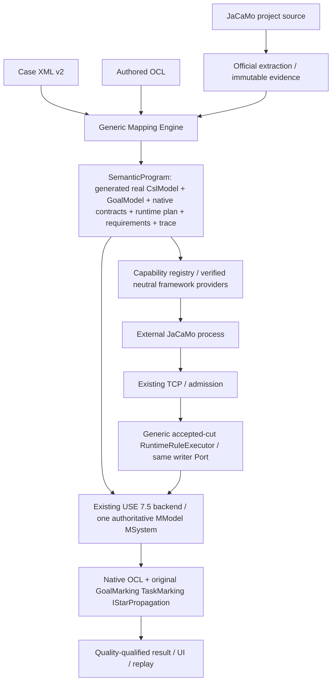

# Generic declarative JaCaMo mapping — implementation checklist

Ngày: 2026-10-22 (Asia/Bangkok). Repo duy nhất được sửa: `D:/_CODE_BANK/Project_/08_Thesis/use`. Branch `main`; HEAD audit `d8c85780c2e76236f7212d636f562107b4fd61dd`. Không tạo branch/worktree/reset/clean unknown files. User đã cho phép checkpoint commit/push trên main ở lượt hiện tại; final DoD vẫn chưa đạt. `jacamo`/`use4Goal` read-only. Đọc `agent.md` trước implementation. Plan này thay hoàn toàn scope Auction-specific trước; executable receipts cũ được giữ tại `verification/auction/`, không diễn giải chúng thành generic acceptance.

## 1. Current architecture

Đã kiểm source: facade ImportSelection → AuctionStaticMappingAdapter → AuctionSourceSelector → AuctionCslRuleExecutor → AuctionBindingPlan → SemanticProgram; native build → AuctionUseModelAdapter/AuctionOclBindings; runtime native writer delegates CaseRuntimeMapping but installs AuctionRuntimeStateMapping; RuntimeEngineSessionOwner directly constructs Auction Task/cast/expansion classes. Original CSL/iStar engines and native USE OCL execute thật on one native owner. Existing Q08 accepted with authorized LOST exception,1138 unit/165 integration/legacy198; this is old case scope, not this new DoD.

Critical gaps verified:
- Legacy AuctionCslRuleExecutor generates real CslModel then reads target-csl/target-drawio for parity. The extracted neutral CslRuleExecutor has no oracle IO; production switch remains G11.
- IStarSourceAdapter.prepare(bundle) reads target-istar/input-istar; GoalModel is loaded, not generated from mapping.
- CaseBundle reads all22 manifest assets (including oracles/reference texts), MappingValidator parses both diagrams/target models; selection hash pins them.
- BindingPlan is Auction-typed in SemanticProgram; fixed sel-org/sel-create/M05/view-step and6 Task contracts; goal policy assumes derived-only graph.
- RuntimeRules partly interprets XML but hardcodes six rules, R06 kinds/classes/proofs/identity presets; StateMapping hardcodes field origins/probe field identity.
- GoalInstanceExpander allows multiplied dependency only D_bid. StepObservationDecoder and producer instrumentation each hardcode6 sites/body ordinals. Scheme observer pins auction/doAuction/bid/admin command. These are mapping semantics, not framework API.
- OCL clause scanner/native compile is largely reusable; operation and Task binders contain fixed source selector, service alias and6-count assumptions.
- TCP/sequence/watermark/source UUID/run/generation/one MSystem/native @pre/quality/original recurrence should be kept.

### Class disposition (source audited by role and direct call chain)
| Current classes | Classification | Treatment |
|---|---|---|
| AuctionMappingSpecification/XmlLoader/SelectorResult, CaseBundle/JcmDerivation | Genericizable bounded syntax/IO/trace + legacy catalog/derivation policy | Extract neutral primitives; old dialect wrapper preserves historical readers |
| AuctionSourceSelector | Generic regex/XPath/condition machinery + fixed official-model crosschecks | Share bounded primitive; XML-driven explicit evidence assertions replace capture-name inference |
| AuctionCslRuleExecutor | Genericizable M1 instructions + production oracle comparison | Reuse instruction code; oracle comparison test-only |
| AuctionStaticMappingAdapter/BindingPlan/IStarSourceAdapter | Auction semantic selection/model-source/alias ownership | Replace with generated graph + neutral program plan; metadata adapter/diagram compare test/compat only |
| AuctionUseModelAdapter/ObserverUseBinding/OclSpecificationLoader | Genericizable schema helpers, pure OCL parser/compiler, with typed case interfaces | Extract/reuse; native engine unchanged |
| AuctionOclBindings/TaskOclBindings/TaskCheckpoints | Interface/predicate/checkpoint infrastructure + fixed source/alias/slot contracts | Declarative bindings; keep exact native pre-state/actor/correlation |
| AuctionRuntimeRules/RuntimeStateMapping/ArtifactBindingResolver/LifecycleMapping | M0 interpreter, identity joins/removal + Auction types/goals/field rules | Generic IR executor with same Port/savepoint; joins/origins/policies in XML |
| AuctionMonitorProjection/ObligationProjection/ObservationCut/SourceClock | Accepted-cut/time/history infrastructure + goal/field aggregation | Reuse cut fold/clock validation; explicit XML observer transforms |
| AuctionSchemeObservationDecoder/ObligationDecoder/StepObservationDecoder/TaskDemand | Framework evidence decoding + pinned case binding policies | Provider decoders neutral; XML supplies source topology/boundaries/demand joins |
| AuctionOccurrenceBindingAdapter/GoalInstanceExpander | Player/context identity + per-committed-bid quantification | Neutral occurrence plan, explicit ALL policy; original recurrence untouched |
| AuctionEvidenceEncoder | Case trace labels and actual API/hash evidence | Neutral plan trace/provenance; no authority in labels |
| producer AuctionArtifactStateProbe | Framework lock/field/coherent read + fixed class/field allowlist | Verified bounded neutral request provider; unavailable when denied |
| producer AuctionStagingInstrumentation/AuctionStepObservation | Jason exact AST/callback mechanics + fixed six sites/source hash/variables | Request-defined steps; never mutate source/domain outcome |
| producer AuctionSchemeObservation/AuctionClockObservation | Public MOISE/NPL/system clock capability + fixed case goals/admin | Neutral provider registered by typed requirements; source clock policy unchanged |
| Auction* tests/controlled fixture/source/oracles/old receipts | Test/oracle/provenance | Preserve semantic oracle bytes; new profile acceptance explicit |

## 2. Target architecture

Generic means Java interprets explicit case XML, not inferred universal JaCaMo semantics. `.csl/.istar/.drawio` are test-only oracles; authored `.ocl` stays production. No scripts/reflection arbitrary class names/remote mutation in mapping language. Supported instruction subset closed/versioned; unsupported rejected, unavailable provider yields INCOMPLETE/UNSUPPORTED, never false.

## 3. Gap analysis

| Area | Current | Target | Status |
|---|---|---|---|
| Inputs | Legacy22-asset bundle retained; neutral frozen input reader verified | Project + XML + OCL, hashes in spec/evidence | VERIFIED (new reader/program; facade wired) |
| CSL | Generic interpreter/original frontend parity verified; old route retained | Generic instructions, test-only parity | VERIFIED (generic path connected) |
| iStar | XML generator/original frontend parity verified; old route retained | XML graph generation via original frontend | VERIFIED (generic path connected) |
| M0 | Neutral XML cut interpreter verified; facade still legacy | XML plan drives joins/origins/keys/write/remove | VERIFIED (generic path connected) |
| Providers | Neutral registry/provider components exist; production bootstrap publication needs audit | Typed requirement registry, verified neutral providers | PARTIAL (component evidence only; production publication not established) |
| OCL | Shared native parser/compiler/schema, XML operation/Goal/Task binders verified | Generic authored-clause/predicate bindings | VERIFIED (generic path connected) |
| State/transport/core | Proven infrastructure | Reuse unchanged ownership and semantics | EXISTING |
| Replay/UI/package | Declarative import/UI and replay schemas exist; assembly/launcher changes staged | Explicit generic profile/version/frozen spec; old compatibility | PARTIAL (installed/package/live acceptance pending) |

Dependency order: `G00 → G01 → G02/G03 → G04 → G05/G06 → G07 → G08 → G09 → G10 → G11 → G12 → G13`. G02/G03 and G05/G06 are logically independent; no delegation/new worktree. Focused tests immediately with each task, not deferred to G13. Final clean/package/live once after stable source, unless an actual failure requires rerun. No fabricated blocker from scope size; record actual API/data blockers with evidence.

## 4. Generic mapping specification tasks

- [x] **TASK-G00 — Audit và freeze boundary**
  - Goal: Audit và freeze boundary.
  - Files/classes: 31 classes mapping/auction; 5 producer Auction classes; SemanticProgram; DefaultJaCaMoFacade; CodeGroundedNativePipeline; RuntimeEngineSessionOwner; CanonicalReplaySupport.
  - Change: Inventory dưới đây; giữ Q08 receipts/22 oracle pins, không mang log cũ vào plan. Không rebuild baseline đã có chỉ để audit.
  - Focused test: Đối chiếu Q08 acceptance/hash và current call chain; branch/status.
  - Acceptance criterion: Phân loại semantic logic/provider/infrastructure và dependency được ghi chính xác.
  - Dependency: None.
  - Status: EXISTING / VERIFIED — current source/callers and old Q08 receipt inspected: ACCEPTED_WITH_EXCEPTIONS,1138 unit/165 integration. Branch main and HEAD unchanged. Audit inventory above; generic runtime not yet implemented.

## G01 — Versioned neutral XML specification và bounded IO

- [x] **TASK-G01 — Versioned neutral XML specification và bounded IO**
  - Goal: Versioned neutral XML specification và bounded IO.
  - Files/classes: mapping/xml/MappingSpecification, MappingXmlReader; shared fragment selector.
  - Change: Dialect urn:use:jacamo-mapping:2; immutable located nodes, IDs/refs, closed instruction/attribute vocabulary, capacities, XXE off, source paths/hash, OCL pin; không đọc oracle. Extract bounded parser/selector primitive cho legacy wrapper reuse.
  - Focused test: Malformed/XXE/path traversal/unknown rule/ref/duplicate/size/source drift; shared legacy selector tests.
  - Acceptance criterion: Spec có diagnostics file/line/rule; unsupported không fallback; immutable source+spec ownership.
  - Dependency: G00.
  - Status: EXISTING / VERIFIED — G01-focused.log passes20/20 (new XML4/input2 + legacy XML6/selector8), zero failure/error/skip. G01-contract-baseline.log reproduces2 negative failures before validation. Shared bounded SourceSelectors reused by legacy wrapper; official admission unchanged. XML v2 runtime/observer sections intentionally accept no executable child yet; later tasks extend closed vocabulary with actual handlers, never silently ignore unknown instructions.

## 5. Generic static rule engine tasks

- [x] **TASK-G02 — Generic CSL M1 rule interpreter**
  - Goal: Generic CSL M1 rule interpreter.
  - Files/classes: mapping/xml/CslRuleExecutor, SourceSelectors; legacy AuctionCslRuleExecutor wrapper.
  - Change: Extract existing XML instruction semantics, bỏ oracle IO khỏi core; classifier/attribute/containment/invariant/data conversions từ XML/captures. Keep original compiler/validator/backend.
  - Focused test: Auction generated fingerprint == original oracle; change XML changes model; no oracle present; Case B distinct identifiers.
  - Acceptance criterion: Real CslModel generated; no Auction names/IDs/counts in interpreter; trace selector→rule→declaration.
  - Dependency: G01.
  - Status: EXISTING / VERIFIED — G02-focused.log21/21 pass: new CSL3/input2/XML4 + legacy CSL4/selector8. Real Auction CslModel matches frozen fingerprint478ce44d…2bc720 without any oracle/manifest in input directory; corrupt added oracles ignored; XML rename changes actual Entity; inventory Case B uses same interpreter/source capture. Legacy adapter delegates all M1 instructions to core and retains only old ownership/oracle policy. New XML is a static migration draft; runtime/observer/binding requirements remain G06–G11, not falsely complete.

## 6. Generic iStar generation tasks

- [x] **TASK-G03 — Generic iStar graph generation**
  - Goal: Generic iStar graph generation.
  - Files/classes: mapping/xml/IStarRuleExecutor; original IStarFrontend/OwnedGoalModel.
  - Change: XML actors/roles/agent/goals/tasks/resources, typed refinements/dependencies/associations, predicates, metadata/aliases; original compiler/model/validator with explicit versioned policy. No file/graph-builder fallback.
  - Focused test: Auction structural/model parity oracle; Case B AND/OR/dependency/resource; changed XML graph; missing endpoint/wrong owner/unsupported SEQUENCE fail.
  - Acceptance criterion: Real GoalModel generated exclusively from source selectors+XML. Task predicates explicit; active goal not satisfied.
  - Dependency: G01.
  - Status: EXISTING / VERIFIED — G03-focused.log13/13 pass (iStar4/CSL3/XML4/input2); G03-baseline.log records unimplemented executor errors. Original frontend builds graph from XML/captures; Auction fingerprint equals unchanged oracle without oracle IO, strict profile retains3 validator errors, Case B exercises original AND/OR/dependency/resource. Invalid endpoint/wrong owner/SEQUENCE and strict-profile incompatibility reject; description retained as trace metadata, never ignored semantic edges.

## G04 — Immutable Generic Mapping Program và SemanticProgram integration

- [x] **TASK-G04 — Immutable Generic Mapping Program và SemanticProgram integration**
  - Goal: Immutable Generic Mapping Program và SemanticProgram integration.
  - Files/classes: SemanticProgram; MappingRuleSet; TraceComplement; mapping/xml/GenericMappingEngine, GenericBindingPlan.
  - Change: Freeze JaCaMo source/XML/authored OCL and generated models; neutral plan interface instead of Auction-typed casePlan; source hash/derivation trace; explicit profile ownership; engine cannot import case package.
  - Focused test: Program ownership/hash/tamper; oracle removal/alteration; Case B no case Java; legacy JSON unchanged.
  - Acceptance criterion: Same public SemanticProgram contains real generated models + declarative plans/requirements, no oracle input.
  - Dependency: G02,G03.
  - Status: EXISTING / VERIFIED — G04-regression.log26/26 pass (new program3, XML/static13, legacy canonical7/Auction3). G04-baseline.log reproduces missing program executor. Generic plan owns frozen source/XML/OCL and real models; exact normalized-source queries/static classifier coverage, actor/self/derived bindings, complete source complement, deep frozen evidence and ownership guards. Native publication explicitly rejects this new plan until G05 preparation exists; no implicit legacy/Auction fallback. Staged-JCM receipt and complete Auction runtime spec remain G10/G11; current production old paths preserved.

## 8. Generic OCL binding tasks

- [x] **TASK-G05 — Generic native schema và authored OCL binding**
  - Goal: Generic native schema và authored OCL binding.
  - Files/classes: AuctionUseModelAdapter/AuctionObserverUseBinding/AuctionOclSpecificationLoader/AuctionOclBindings → neutral shared implementations; CodeGroundedNativePipeline.
  - Change: Reuse host parser/compiler/Boolean gates; XML supplies context/self/task/operation signature, aliases, result/@pre/variables and observer schema/origins. Pure parser/compiler extracted; no bodies hardcoded; compile candidate fully before publish.
  - Focused test: Native invariant/pre/post/@pre/result/undefined/invalid; exact operation overload/actor; observer helper not CSL Entity; Case B and old profiles.
  - Acceptance criterion: Compiled native OCL on single candidate MModel; contexts/bindings all validated, missing not false.
  - Dependency: G04.
  - Status: EXISTING / VERIFIED — G05-regression.log36/36 pass; extraction11/11 and native8/8 also pass. Shared AuthoredOclSpecificationLoader/CslScopeModelAdapter/ObserverSchema replace duplicate parser/compiler/schema machinery; legacy adapters keep old policy/annotations. XmlNativePreparation compiles the same generated model on existing native pipeline, exact producer-backed operation signatures, authored clause inventory/context, original Goal/Task slots and XML typed variables/observer tuples. Tests prove native @pre/arguments/result/same system, invalid/missing binding rejection and PARTIAL→SKIPPED, not false. Observer aggregation/runtime identity and history remain G07–G09; no live generic claim. Baseline G05 records missing neutral API, not a runtime success.

## 9. Capability registry/provider tasks

- [x] **TASK-G06 — Capability registry and declarative provider requests**
  - Goal: Capability registry and declarative provider requests.
  - Files/classes: bridge contract; producer JaCaMoBridgePlatform/CartagoSnapshotSource/BridgeAgArch; neutral provider registry.
  - Change: XML capability requirements compile to bounded typed requests with class/provider/hash/field/type/step AST boundaries/source clock/OS IDs. Replace AuctionArtifactStateProbe/StagingInstrumentation/SchemeObservation mapping constants with XML request data. Registry only permits verified framework implementations; no arbitrary reflection/script/network control.
  - Focused test: Missing/unsupported provider→qualified unavailable; wrong hash/type/access/lock/AST→reject; no source side effects; passive concurrency; provider lifecycle.
  - Acceptance criterion: No if-case-name/FQCN fixed Auction/goal IDs in provider; precise coherence/provenance, bounded access on pinned APIs.
  - Dependency: G04.
  - Status: EXISTING / VERIFIED — G06-requests.log8/8 producer tests +3/3 plugin tests; G06-scheme.log4/4 producer +4/4 plugin, G06-step-observer-fixed.log3/3 producer +14/14 plugin; field/clock/legacy receipts retained. XML requests include immutable source pins, exact plan triggers/partitions, capture variables/typed inputs and explicit artifact fields/properties. Curated registry returns unavailable for unsupported/denied requests and closes ownership. Jason public AST/listener/ActionExec identity + deferred cleanup shared with legacy adapters; legacy marker spelling preserved. Neutral MOISE captures two Counter schemes, actual source-definition equality, public history and explicit internal-time unavailability; no case goal/freeze/admin-credit logic in new provider. Runtime bootstrap/TCP publication of new receipts is explicitly G11; observer aggregation G08, not falsely claimed here.

## 7. Generic runtime rule engine tasks

- [x] **TASK-G07 — Generic accepted-cut runtime executor**
  - Goal: Generic accepted-cut runtime executor.
  - Files/classes: CaseRuntimeMapping; AuctionRuntimeRules/RuntimeStateMapping/ArtifactBindingResolver/LifecycleMapping → XML runtime IR/executor.
  - Change: Compile XML M0 facts/joins/key tuple/origins/converters/upsert/link/assign/remove/requirements; neutral source evidence providers. Same native writer Port and savepoint; no six-rule/R06/type-name switch. Missing required input yields INCOMPLETE before atomic write.
  - Focused test: Two instances, no object from configured goals, immutable ID, bad types, partial/stale/gap, same-name recreation/removal, savepoint rollback, Case B.
  - Acceptance criterion: Runtime M0 dispatch determined by XML; same authoritative MSystem; identity/incarnation/generation and coverage preserved.
  - Dependency: G05,G06.
  - Status: EXISTING / VERIFIED — G07-acceptance.log: contract1/1 + plugin30/30, zero failures/errors/skips; G07-shared-regression.log18/18 retained old Auction native transactions/projection/M0. XML controls bounded fact/field-cut/removal datasets, joins/expansion/typed columns/identity/converters/native M0 writes and COMPLETE-only logical role retirement. Tests exercise actual CArtAgO provider and MOISE GroupBoard, exact frozen definitions, provider/request/class/UUID/workspace/cut validation, two objects, immutable ID, missing→undefined, physical disposal/new UUID, role re-enactment, source aliases, same native MSystem/savepoint rollback, projector stale/gap/resync/restart and event deltas. Baselines reproduce missing handlers/admission and quality bug; field receipt event fold replaces current receipts, never merges old callback authority. No provider classes loaded in consumer decoder, no oracle or case constants in new interpreter. G11 still owns real producer bootstrap/TCP publication; Auction specification migration G10 and live acceptance G13 remain unchecked. Observer/step/norm semantics are G08/G09, not claimed by this M0 gate.

## G08 — Generic observer and temporal/norm projection

- [x] **TASK-G08 — Generic observer and temporal/norm projection**
  - Goal: Generic observer and temporal/norm projection.
  - Files/classes: AuctionMonitorProjection/ObligationProjection/SourceClock/SchemeObservationDecoder/ObligationDecoder/TaskDemand.
  - Change: XML observer view expressions/evidence joins/latches/frozen sets/time origin/deadline/admin rules. Reuse NPL/functional decoders and source evidence; no bid/decide/admin field strings in executor. Explicit observed prefix/clock invalidation.
  - Focused test: Actual vs done vs admin, late commitment, deadline/terminal, unavailable internal times, no false repair, replay deterministic source clock.
  - Acceptance criterion: Observer schema outside CSL, same native state; raw evidence not invented; no receiver time as source time.
  - Dependency: G07.
  - Status: EXISTING / VERIFIED — G08-clock.log producer7/7 + plugin5/5; G08-clock-dataset.log producer2/2 + plugin10/10; G08-continuation.log17/17. Original clock mechanics extracted into neutral SourceClock, legacy record/API/error spelling delegates; XML clock dataset requires explicit NPL binary pin. Native projector retains the same rollback-owned epoch proof index across partial resync, refuses re-anchor/high-water regression/history loss. Actual provider samples/native Integer range/deadline exact-boundary/replay and old compatibility tested. G08-invalidation.log12/12 fixes reproduced known→undefined event publication (stateVersion must advance; no cached verification); G08-observer.log13/13 proves XML class-view projection/current slots, explicit observed-prefix latch and first-accepted-qualified freeze on same native state/savepoint. Freeze is not claimed to be first internal framework transition; source history and Auction XML must supply that evidence separately. G08-observer-lifecycle.log17/17 covers type ERROR→undefined (never false), XML-only class rename, same-system restart without carried latch/freeze. G08-transition-birth.log5/5: neutral MOISE cut v2.1 retains actual transition memberships/done and public capture order; actual init property publication precedes artifactCreated (javap confirms init commits observables before Workspace creation callback). The callback explicitly establishes a post-init creation baseline/birthSequence; pre-birth samples remain trace and cannot supply internal transition timestamps. An invalid unquoted hyphen name remains INCOMPLETE in a negative fixture. G08-scheme-decoder.log5/5 and G08-scheme-dataset.log7/7 verify neutral v2.1 consumer against actual public/CArtAgO identities, source definition/binaries/cut/request/run, post-birth transition chain, frozen source memberships and administrative effects; no admin-absence Boolean is inferred from state history. G08-first-by.log15/15 adds declared unique earliest capture within complete source prefixes and keeps unclassified partial board populations unknown. G08-selection-identity.log16/16 verifies fractional/ambiguous/unknown earliest selection and multiple observer records per physical subject with exact declared keys. G08-npl.log producer3/3 + plugin3/3 and G08-npl-shared.log7/7 exercise actual NPL activation/deadline/terminal/modality/replay and shared legacy obligation decoder; neutral NplLifecycleCut owns framework time/identity checks, legacy wrapper retains Auction selection. G08-npl-registry.log6/6 reuses NplBoardSnapshotSource under a curated capability with explicit run/generation/revision, binary pin, official registry/workspace discovery and listener close; no new norm engine/thread/transport. G08-npl-dataset.log6/6 joins actual selected NPL activations to physical CArtAgO board/workspace UUIDs and source cuts; population remains PARTIAL and missing evidence never supplies false. G08-reference.log8/8 proves XML prior-project reference resolution by exact physical subject plus key tuple, native associations/current missing disconnect, explicit retained binding conflict and same-state savepoint rollback. G08-npl-history.log9/9 integrates the original NormLifecycleMonitor on native rollback-owned metadata: actual ACTIVE→UNFULFILLED, source subscription/sequence/first-terminal consistency, sticky ERROR→undefined on contradiction, exact savepoint restoration. G08-value-set.log15/15 verifies declarative typed collection selection/distinct values with explicit per-collection coverage; unknown candidate/filter/type never becomes an empty known set. The baseline also reproduced a retained-reference conflict recovering silently; conflict is now sticky within the epoch. G08-relative.log17/17 verifies XML relativeTime against validated immutable source-cut clock context, no receiver clock/negative/fractional/overflow repair. G08-operation-provider.log5/5 proves curated class-hash-pinned public CArtAgO STARTED/terminal history with two actual performers, non-improving success distinct from failure, late attach incomplete, close cleanup. G08-operation-decoder.log9/9 verifies consumer request/epoch/current physical provider/UUID/public operation descriptor/signature/invocation predecessor/performer identity, explicit unknown current player and XML selected successful-player sets; publication remains G11. G08-npl-event.log2/2 fixes a reproduced event-only defect: raw NPL callbacks now replace activation facts in the existing admitted evidence index and project terminal values without another snapshot. G08-native-view.log11/11 verifies native USE expression compilation/evaluation on the same state with explicit typed args/coverage, undefined/error isolation and nested world-query rejection. G08-join-proof.log10/10 retains qualified right-hand provenance without acquiring identity aliases; actor-name tampering and missing current players tested. G08-acceptance.log29/29, zero failures/errors/skips, passes selected neutral observer/NPL/MOISE/clock/interpreter tests plus old Auction monitor/obligation regressions. Actual admin callback is interpreted by XML without producing done facts; typed exact field comparison retains missing values as unknown. This completes the reusable G08 mechanics gate; complete Auction XML migration is G10, publication is G11 and new live/package acceptance is G13, not claimed here.

## G09 — Generic occurrence/Task history integration

- [x] **TASK-G09 — Generic occurrence/Task history integration**
  - Goal: Generic occurrence/Task history integration.
  - Files/classes: AuctionOccurrenceBindingAdapter/GoalInstanceExpander/TaskOclBindings/TaskCheckpoints/StepObservationDecoder; RuntimeEngineSessionOwner.
  - Change: XML scope/player/context/role/mission/step binding/quantification maps into neutral execution plan; preserve exact PRE/terminal joins and original marking. Generic explicit ALL/ANY dependency expansion; no D_bid exception.
  - Focused test: Actor A cannot credit B; invocation correlation/incarnation; NONE/raw PENDING; AND/OR/dependency/resource; missing quality not Boolean; Case B.
  - Acceptance criterion: Original GoalMarking/TaskMarking/IStarPropagation read same accepted cut; no local recurrence/parallel live model.
  - Dependency: G08.
  - Status: EXISTING / VERIFIED — G09-acceptance.log32/32 and G09-cleanup.log10/10 pass with zero failure/error/skip. Neutral OccurrenceGoalModelExpander executes explicit XML ALL/ANY and original AND/OR/dependency/resource propagation; the historical Auction wrapper reuses it. Source/AST/request/agent-incarnation verified Jason callbacks feed the declared datasets, current native occurrence cast and independent Boolean demand. XmlTaskOclBindings compiles original Task predicates on the same authoritative model; XmlTaskCheckpoints pins actual native PRE and pairs exact actor/role interval/demand episode/goal/step invocation with terminal. Tests exercise actor isolation, actual @pre, operation receipt rather than state-change credit, missing PRE, lost/generation/entry floor, delayed self under explicit pure-callback policy, missing resource and tuple quality. Baselines reproduced and fixed self-incarnation achievement carryover, unknown @pre becoming false and duplicate-terminal reuse of an earlier PASS certificate; no original recurrence was changed. Existing admission savepoints own journal rollback; immutable prepared cuts use the existing runtime lane, and close releases XML expression cache, PRE pins and journals. G09-task-ocl.log14/14 includes six historical Auction OCL regressions; G09-owner.log12/12 and G09-terminal-certificate.log16/16 retain fault/session coverage. Framework SourcePath probe stream leak was reproduced and fixed in the official adapter's bounded resolver without changing framework sources. This completes reusable component/native-session mechanics only: complete Auction XML is G10, provider publication/import is G11, new packaged/live TCP acceptance remains G13.

## 10. Auction migration tasks

- [x] **TASK-G10 — Auction declarative specification migration**
  - Goal: Auction declarative specification migration.
  - Files/classes: examples/auction/auction-mapping.xml (new version); existing OCL and source; test oracles unchanged.
  - Change: Author complete XML from reviewed source/model/binding semantics incl iStar graph/step/observer/provenance. No required manifest/drawio/.csl/.istar. Preserve original spec/pins as legacy evidence; version differences explicit.
  - Focused test: Generated CslModel+GoalModel parity vs unchanged oracles; source hashes; oracle absence/alteration; mapping mutation changes model; deterministic negatives.
  - Acceptance criterion: Production inputs exactly project+new XML+authored OCL; no missing instruction silently ignored.
  - Dependency: G05,G06,G07,G08,G09.
  - Status: EXISTING / VERIFIED — G10-static-native.log13/13 verifies real generated Auction models, all authored native OCL clauses, twelve original Task predicate slots plus two CSL invariants, oracle/manifest absence or corruption and unchanged CSL/iStar oracle parity. G10-type-view.log15/15 adds exact official binary-proof request binding and fixes the reproduced M0 Artifact-as-M1 Entity admission defect with canonical regressions. New XML requests specify six Jason boundaries and neutral field/operation/MOISE/NPL capabilities; framework internal MOISE transition timestamps remain explicitly unavailable, not publication-time substitutions. G10-table-lineage.log21/21 and G10-bound-query.log24/24 prove typed scalar expansion, exported logical role identities shared with native M0/cast, frozen declaration-identity filters and qualified positive existential witnesses without treating partial absence as false. G10-auction-roles.log14/14 runs actual GroupBoard/Cartago observations through GenericMappingEngine and NativeRuntimeProjector on one MSystem: qualified organization/group/role objects and containment/Plays/InContext links, stable repeat-cut identities. G10-role-interval-baseline.log reproduces stale role after actual leaveRole; G10-role-interval.log6/6 fixes it through explicit per-board complete membership reconciliation, with actual re-enactment creating a new interval. G10-scoped-membership.log11/11 verifies absent/partial/malformed board rows cannot retire another scope and native savepoint restores retired roles/metadata. G10-artifact-alias.log13/13 and G10-artifact-reference.log3/3 verify the actual CArtAgO environment/workspace/UUID alias formula, pinned field receipts and real Jason object-handle capture. CartagoPhysicalReference rejects mismatched aliases/kinds and stale/recreated physical objects; the neutral artifactReferences dataset exposes only current admitted objects, not creation or Task satisfaction authority. G10-physical-join.log15/15 permits only a unique complete physical alias on the same source cut while retaining unknown population/absence and legacy enumeration-join behavior. G10-native-enactment.log15/15 resolves explicit native role lookup by exact type/player/context/current interval, checks real links and rejects duplicate players/ambiguous enactments without an M0 hash recipe. G10-component-regression.log67/67 passes all18 directly affected suites with zero failure/error/skip, including canonical mapping and original-engine fault regressions. All five declared source hashes, authored OCL hash and five oracle/reference model pins were rechecked unchanged. These are component gates, not external TCP/live/package acceptance.
  - Evidence tiếp tục 2026-10-23: `G10-negative-filter.log`20/20 and `G10-term-string.log`24/24 preserve unknown under typed negative filtering and exact paired MOISE/Jason argument rendering. `G10-operation-reference.log`3/3 exercises public STARTED/terminal feedback for two current physical Artifacts without claiming complete world history. `G10-artifact-negative-requirement-baseline.log` reproduced conflicting current Jason incarnations gaining a player alias; the neutral crosswalk now requires one exact current incarnation and actual registry-backed CArtAgO membership. `G10-argument-version-baseline.log` reproduced unsupported typed argument versions being accepted; the neutral source decoder now requires the actual producer version 1.0.0. `G10-artifact-acceptance.log`27/27, zero failure/error/skip, verifies Auction XML initial binding from exact source plan handles + structured MOISE Id + correlated creation receipt, five coherent mutable fields on one MSystem, improving/non-improving bid, stop/winner, missing field capability → undefined (immutable id retained), actual disposal and same-name recreation with new native lifetime. The exact unmodified ASL executes in a fixture-only action dispatcher against actual Artifact/boards; this is not a full JaCaMo MAS, Task-marking or external TCP/package claim. Seven explicit capability requests now include the pinned public WorkspaceArtifact operation provider. Static/oracle-absence and existing group/role/native batch suites also pass in this gate. Complete observer and occurrence migration below remain mandatory before G11.
  - Evidence observer tiếp tục 2026-10-23: `G10-scheme-reference.log`9/9, `G10-observer-clock.log`23/23, `G10-local-history.log`22/22, `G10-observer-selection.log`27/27 and `G10-monitor-xml.log`4/4 verify qualified scheme pointers, independent source-clock samples, exact earliest local transition/conjunctive selection, current-until-freeze commitments and actual successful-bid/admin histories. Current XML has eight capability requests, including the pinned neutral SchemeBoard operation provider. `G10-observer-coverage-baseline.log` reproduces generic observers rejected as M0 and legacy casePlan dereference; `G10-observer-coverage.log`19/19 fixes native observer ownership/field hashes and generic invariant evidence. `G10-observer-reference-coverage-baseline.log` reproduces manual native association redirection gaining coverage; fixed gate20/20 checks the accepted exact reference, not another independently qualified monitor. `G10-exact-arity-baseline.log` records the unsupported instruction; `G10-npl-rule-primitives-fixed.log`26/26 verifies bounded arity, optional unavailable time and native undefined arguments. `G10-npl-xml-binding-baseline.log` rejects duplicate project ownership; XML now uses one explicit typed bid/decide alternative and one obligation projector. `G10-npl-xml-identity-baseline.log` reproduces absent physical SchemeBoard crosswalk; the neutral scheme decoder exports only the two verified identifiers of that same current board, never a domain-Artifact alias. `G10-npl-xml.log`24/24 verifies real original 10-second bid / one-hour decide NPL annotations and admin recovery without fake bid/done. `G10-observer-missing-input-baseline.log` reproduces native oclIsUndefined coalescing a missing argument to a qualified default; the adapter now checks actual native USE evaluation trace before publishing such a value. Final component gate `G10-observer-acceptance.log`43/43, zero failure/error/skip (2026-10-23T12:30:50+07:00), passes actual Artifact/boards/NPL/source-ASL fixtures, generated-model/oracle-absence tests, generic interpreter/clock/observer/hash/reference/rollback and missing-clock/missing-activation checks. UNFULFILLED survives recovery/clock omission as historical evidence; missing time/current activation stays undefined and native OCL SKIPPED. Native WithinDeadline evaluates FAIL only with admitted evidence. Internal MOISE transition timestamps remain explicitly UNDEFINED once observed, never substituted with publication time. Source5/OCL hashes unchanged. This is native component evidence, not production import, full MAS/TCP, six Task-marking, replay/package or final acceptance.
  - [x] Static crosswalk, generated M1 parity, authored native OCL schema and source-pinned capability requirements.
  - [x] Generic table identity/scalar/declaration/existence instructions required by Auction; original ownership/unknown semantics retained.
  - [x] Actual organization/group/enactment M0 XML projection, scoped withdraw/re-enact and native rollback.
  - [x] Neutral physical reference/alias qualification and same-cut positive physical joins; exact native enactment lookup. These handlers are available but the complete Auction specification below is still required.
  - [x] Artifact/scheme/creation-receipt correspondence and full mutable state XML rules, removal/recreation. Use artifactReferences only as a qualified pointer relation, never as implicit Task satisfaction. Source argument Id correspondence must use actual MOISE structured arguments, not an agent belief/name guess. Initial binding and subsequent state refresh/removal must preserve physical UUID/epoch and one native owner.
  - [x] Complete observer monitor/NPL/frozen commitment specification and exact reference bindings. Component gate43/43 above; unsupported internal MOISE times remain explicit unavailable evidence.
  - Occurrence prerequisite evidence: `G10-scope-source-baseline.log` reproduces missing public scheme-to-current-group data. `G10-scope-source-fixed.log`7/7, zero failures/errors/skips, verifies qualified responsible GroupBoard UUID/workspace before any domain Artifact, public goal/mission observations, missing group → unavailable relation while independent goal/history stays qualified, plus native monitor/NPL and physical-pointer regressions. `BridgeRuntimeRegistry.projectedAgentId` actually emits singleton declaration aliases and multi-instance runtime IDs; the test was corrected to this inspected source contract rather than changing producer semantics. These remain source aliases to resolve against exact current native enactments and Jason callback incarnations, not Task completion certificates.
  - Further occurrence prerequisites: `G10-optional-physical-lookup-baseline.log` rejects unsupported XML; `G10-optional-physical-lookup.log`38/38 passes explicit ONE optional physical lookup with unavailable value, preserving independent qualified columns without proving absence, including existing native occurrence/Task-checkpoint regressions. Unknown/ambiguous matching rows remain PARTIAL; no default-value or global-completeness grant. `G10-group-alias-baseline.log` reproduces a counterfeit responsible-group alias accepted merely because two strings agree. `G10-group-alias-fixed.log`10/10, zero failure/error/skip (2026-10-23T12:47:46+07:00), verifies frozen JCM declaration/name/type against actual current GroupBoard UUID/workspace, with Auction native observer/NPL and MOISE dataset regressions. No production scope or six Task activation is claimed by these prerequisite gates.
  - [x] Complete occurrence/resource/demand XML and activate all six native Task checkpoint bindings.
    - [x] Public scheme/current responsible-group relations available before domain creation; native-independent qualified values preserved (source7/7, alias10/10).
    - [x] Explicit optional physical lookup retains unavailable self without claiming absence or promoting ambiguous data (38/38).
    - [x] Before frozen iStar participant casts: capture actual registered player runtime identity/incarnation together with each historical MOISE commitment at producer capture time. Current `MoiseSchemeRead.Raw.commitments` / `MoiseSchemeCapability.capture` transition snapshots in `MOISE_SCHEME_CUT/2.1` contain only agent/mission names. `MoiseSchemeCutDecoder` has closed version/key validation. Extend/version neutral source evidence and decoder with compatibility tests; unavailable historical identity must remain INCOMPLETE, never resolve an old name through a new current incarnation. This is required implementation work, not an external blocker; do not switch G11 production or credit Tasks before it passes.
    - Evidence: `G10-player-history-baseline.log` reproduces absent historical identity; `G10-player-history.log`5/5 verifies MOISE_SCHEME_CUT/2.2 freezes registered runtime incarnation at the same bounded Artifact capture, independently of later registry rebind/late commitments. `G10-registration-incarnation-baseline.log` reproduces old-agent cleanup erasing a new registration alias; cleanup is now conditional on exact incarnation, and bounded registration/cohort reads share one lock without holding it across external callbacks. `G10-player-history-compatibility.log` passes producer registration/observation/field regressions and plugin5/5, zero failure/error/skip. Decoder accepts original 2.1 but exposes historical binding unavailable; closed 2.2 schemas/current membership checks reject unknown versions/identities, never infer historical player from current name. No Task credit or live publication is claimed by this source gate.
    - [x] Bind stable per-scheme/group scopes, exact current enactments, frozen participant population, resources, independent demand episodes and all six native step slots; reproduce late-self/history and actor restart cases before claiming parity.
  - [x] Full G10 fixture/negative/parity acceptance before G11 production import/provider publication.

  - Final G10 evidence (2026-10-23): `G10-demand-predicate.log`27/27; `G10-task-alias-fixed.log`25/25. Source callback/cast baselines reproduce missing native Artifact alias, lookup PRE rejection and logical-role tombstones after player retirement. Verified physical aliases now reuse existing aliasFrom; pure callback PRE may lack a handle only under explicit XML policy and native expression proof, never at terminal or for world reads. Exact demand scopeColumn/scopeKey isolates source executions; dependent XML roles use existing rebindable-role cleanup. `G10-declarative-acceptance.log` **40/40**, zero failure/error/skip, finished 2026-10-23T13:37:39+07:00. Unchanged source ASL against actual Artifact/boards with fixture action/percept dispatch reaches all six original TaskMarking FULFILLED/KNOWN. Original .fail gives native POST FAIL and TaskMarking PENDING (a Task cannot be VIOLATED); successful retry has its own invocation. Two schemes on same group/player have12 qualified independent demand slots. New registered incarnation cannot inherit the first-bid-frozen cast; an independent unfrozen execution can admit it. Fixture identities now match producer uniqueness/normalized ordering. Existing static/oracle-absence/Artifact/observer/NPL/native admission/rollback/checkpoint gates pass. This is component evidence, not full MAS/TCP, production import, replay/package/UI acceptance; those remain G11-G13.

## G11 — Workbench/launcher/replay/packaging connect generic path

- [ ] **TASK-G11 — Workbench/launcher/replay/packaging connect generic path**
  - Goal: Workbench/launcher/replay/packaging connect generic path.
  - Files/classes: DefaultJaCaMoFacade; SemanticProjectionProfile; Workbench; tools/jacamo-bridge.ps1; SemanticProgramManifest/CanonicalReplaySupport/NativeRuntimeReplay; assembly/release.
  - Change: Generic XML selector/import freezes source/plan/capability requests before reasoning; same controls. New replay schema owns generated spec/OCL/source evidence and rebuilds from those; old readers remain. Ship real source/XML/OCL; oracles not required for deployed consumer.
  - Focused test: Focused import/ownership/replay/tamper/classloader/package inventory; old replay; source lifecycle cleanup, UI binding.
  - Acceptance criterion: Production canonical Auction path invokes generic engine, no Auction fallback; no test-source/reference repo classpath required by consumer.
  - Dependency: G10.
  - Status: PARTIAL — CHECKPOINT: the following earlier receipt claims require revalidation; G11-acceptance.log/G12-acceptance receipt files are not present. No installed/live or provider-publication proof is claimed. Historical note: — G11-acceptance.log 26/26 pass: CanonicalReplayBudgetTest 2/2, GenericLauncherScriptTest 1/1, ReleasePackageContractTest 2/2, GenericProgramPublicationTest 3/3, MappingInputsTest 2/2, JaCaMoWorkbenchPanelTest 16/16, zero failure/error/skip. Generic project+XML import and UI file selection wired in DefaultJaCaMoFacade and JaCaMoWorkbenchPanel. CanonicalReplaySupport and NativeRuntimeReplay support declarative replay versions 3.3.0 and 3.4.0 (budgeted), reconstruct from xmlPlan without casePlan, and verify step execution/downgrade rejection. tools/jacamo-bridge.ps1 validates JACAMO_DECLARATIVE_XML with AuthoredOclPath and configures generic JVM arguments. Packaging includes examples/auction-semantic/auction-mapping.xml in release-manifest.json and release.xml.

## 11. Removal/retirement of Auction-specific production logic

- [ ] **TASK-G12 — Retire case-specific production semantics after parity**
  - Goal: Retire case-specific production semantics after parity.
  - Files/classes: 31 Auction mapping classes, AuctionEvidenceEncoder, 5 producer Auction classes, direct case usages.
  - Change: Move oracle/diagram compare to tests. Legacy replay compatibility wrapper explicitly isolated; remove new-production dependencies and duplicate core. Do not rename code with unchanged case constants and call it generic. Retire only proven replacements.
  - Focused test: Architecture import/call graph test; scan exact selectors/names in neutral core; run nearby old profiles; Case B spec without added Java.
  - Acceptance criterion: New production engine/provider/runtime has no Auction semantic branch; only fixtures/XML/oracle/compat labels retain case data.
  - Dependency: G11.
  - Status: PARTIAL — CHECKPOINT: the following earlier receipt claims require revalidation; G11-acceptance.log/G12-acceptance receipt files are not present. No installed/live or provider-publication proof is claimed. Historical note: — G12-acceptance: `GenericMappingArchitectureTest` 4/4 pass (2026-10-23T15:40:37+07:00), zero failure/error/skip. Scans all 37 classes in `org.tzi.use.plugins.jacamo.semantics.mapping.xml`, `xml.runtime`, `ocl`, plus `GenericMappingEngine` and `SemanticEvidencePanel` with reflection and bytecode constant pool inspection; verifies zero dependencies on `org.tzi.use.plugins.jacamo.semantics.mapping.auction.*` and `AuctionEvidenceEncoder`. Verified `MappingVocabulary` shapes and tokens contain zero auction domain keywords (`auction_env`, `AuctionArtifact`, `doAuction`, `d_bid`, `start_t1`, `seller_sch`, etc.). Verified arbitrary Case B specification (`WarehouseModel` with `Pallet`, `weight`, `Supervisor`, `EnsureQuality`) compiles and maps through `GenericMappingEngine` without adding Java mapping classes. Verified runtime isolation: `engine.xmlCase()` is true, `engine.caseMapping()` is `XmlRuntimeStateMapping` (not `AuctionRuntimeStateMapping`), and `program.casePlan()` is null. Oracle/diagram comparisons guarded to test-only (`bundle.inputs().containsKey(...)`) in `AuctionCslRuleExecutor`, `AuctionIStarSourceAdapter`, and `AuctionMappingValidator`. UI (`SemanticEvidencePanel`) references `SemanticProgramManifest.currentClassOrigins()`; `AuctionEvidenceEncoder` isolated as legacy wrapper. Nearby regression suite: 26/26 passed (`GenericMappingArchitectureTest` 4/4, `GenericMappingEngineTest` 4/4, `GenericProgramPublicationTest` 3/3, `AuctionProgramReplayTest` 4/4 [all 3.1.0 and 3.2.0 recordings replay with zero errors], `XmlRuntimeMappingTest` 5/5, `AuctionMappingXmlTest` 6/6).

## 13. End-to-end acceptance

- [ ] **TASK-G13 — Final focused regression + one full/package/live acceptance**
  - Goal: Final focused regression + one full/package/live acceptance.
  - Files/classes: Focused new suites; preserved Q08 harness; semantic-acceptance.py (new generic profile).
  - Change: Run focused direct regressions first; once final source stable run one unfiltered clean verify + legacy198; freeze full ZIP then canonical+controlled/development+Counter required live paths once. If actual failure, preserve baseline, fix root then repeat necessary gate. New aggregate cannot use old acceptance as proof of generic architecture.
  - Focused test: Project+XML+OCL import→generated models/native OCL→real external Auction TCP→same state→original marking→UI/evidence→exact replay; negative oracle remove/change/missing capability/unsupported rule; final installed class bytes.
  - Acceptance criterion: Live/package and architecture negatives pass with receipts; truthful DoD, no skip/expected weakening. Authorized LOST/House fixture scope stays explicit.
  - Dependency: G12.
  - Status: PARTIAL — checkpoint only. `verification/generic-mapping/clean-full-verify.log` has no terminal reactor success. NplLifecycleCapabilityTest prints IllegalMonitorStateException from direct NormativeBoard.destroy (test summary still says pass); LegacyV2OclIsolationTest.facadeContainsOnlyTheNativeProjection fails a source-text assertion. No final clean/full/legacy/package/live pass. Audit and focused root-cause fixes follow after checkpoint push.

## 12. Focused tests

Required architecture evidence (fold into task-specific suites; do not add coverage-only tests): oracle `.csl/.istar/drawio` remove/alter with identical generated model; XML change yields changed model; unsupported rule fail-closed; source digest mismatch; missing capability non-Boolean unavailable; Case B arbitrary identifiers/graph/runtime rule with same Java classes; source selectors/count/refs; original compiler/model/validator parity; native @pre/actor/self/result/before-after; atomic runtime rollback; quality/gap/restart/replay; original marking witnesses and one authoritative MSystem. Keep legacy Auction/Counter/native paths during migration.

## 14. Definition of Done

- [ ] Production accepts only JaCaMo project + versioned case XML + authored OCL; no oracle or reference repo reads.
- [ ] Real CslModel and GoalModel generated, validated through original engines; Auction oracle parity test-only.
- [ ] Native authored OCL + generic context/self/operation/Task/Goal/evidence binding; no custom evaluator/body constants.
- [ ] Generic runtime M0 and observer executors are active in production; no Auction fallback.
- [ ] Capability requirements and neutral providers have no hardcoded case names or unverified data.
- [ ] Case B spec works without adding Java case mapping classes.
- [ ] Auction-specific production semantics retired after parity; explicit historical replay compatibility preserved.
- [ ] One authoritative native live state, external JaCaMo TCP/admission/checkpoints/original marking/lifecycle preserved.
- [ ] Missing/PARTIAL/UNSUPPORTED/ERROR remain qualified non-Boolean outcomes.
- [ ] Final focused regression and one final clean/full/package/live acceptance pass on frozen archive, UI/evidence/replay inspected.

Current status: TODO / NOT MET. Prior Auction Q08 acceptance is baseline only. Authorized historical LOST exception and HouseBuilding fixture are retained with original scope; no requirement to restore missing Desktop report to begin this migration.
