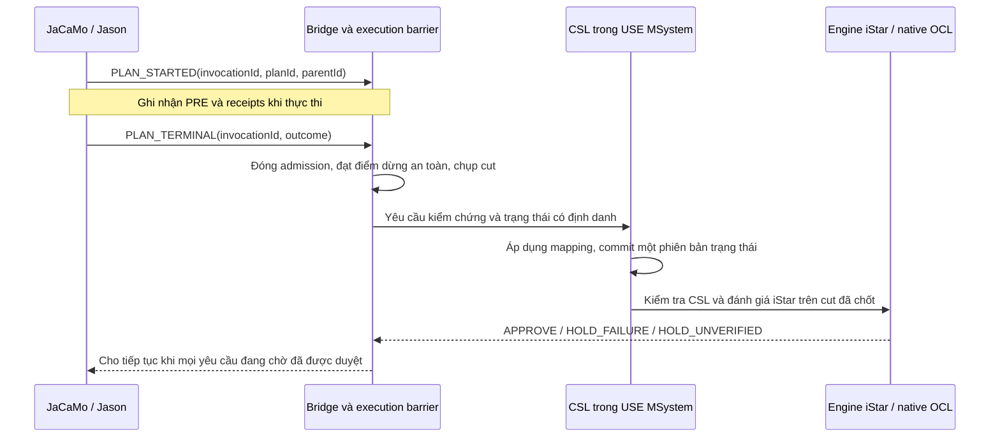

# Thiết kế kiểm chứng CSL/iStar sau mỗi lần thực thi plan

**Cập nhật theo yêu cầu tiếp theo của người dùng:** mapping chỉ nối thuộc tính
JaCaMo với CSL; iStar chỉ đọc CSL. Bản triển khai chạy được nằm trong
`modules/state-verification`, hướng dẫn tại
`examples/auction/state-only/README.md`. Đề xuất ban đầu bên dưới có liên kết
Task/action và policy giữ khi source FAILED; các phần đó đã được thay bằng
đánh giá state độc lập, outcome nguồn chỉ là audit metadata.

Trạng thái: **đề xuất thiết kế, chưa triển khai**. Đối chiếu với checkout
`168547d7` ngày 2026-11-12. Ví dụ cú pháp bên dưới chưa được parser hiện tại hỗ trợ.

## 1. Yêu cầu và khác biệt so với hiện tại

Sau mỗi lần thực thi một plan Jason, JaCaMo phải tạo yêu cầu kiểm chứng và chờ
quyết định tương ứng. USE cập nhật trạng thái CSL từ dữ liệu JaCaMo qua mapping,
đánh giá các invariant CSL và các điều kiện iStar/OCL áp dụng, rồi mới cho phép
tiếp tục thực thi. Cả kết thúc thành công, thất bại và hủy thực thi đều cần có
kết quả được ghi nhận. Sự kiện kỹ thuật chuyển hàng đợi không phải hủy plan.

Mapping Auction hiện tại đã là compact v3, dài 65 dòng. Phần còn phụ thuộc mạnh
vào cách viết ví dụ là lựa chọn đoạn thân plan như `[0..5]`, khai báo biến capture,
Artifact/scheme và action receipts cho từng Task. Rút số dòng XML chưa giải quyết
được yêu cầu kiểm chứng mọi plan: `CheckpointPolicySelection` hiện sinh
`TASK_PRE`/`TASK_POST` từ các Task được chọn trong mapping.

Một plan chưa liên kết với Task iStar vẫn phải tạo yêu cầu kiểm chứng. Khi đó USE
kiểm tra các điều kiện trạng thái và cập nhật các Goal có điều kiện phụ thuộc vào
trạng thái ấy. Không cần tạo Task giả để có một checkpoint.

## 2. Kiến trúc đề xuất



JaCaMo tiếp tục sở hữu việc thực thi. File mapping mô tả tương ứng giữa hai mô
hình; Bridge vận chuyển dữ liệu và quyết định. CSL/iStar dùng chung MSystem,
không phải hai bản sao trạng thái tự cập nhật lẫn nhau.

Giữ lại native writer, snapshot/journal, engine marking/propagation, Bridge xác
thực và execution barrier đang có. Bổ sung sự kiện và cơ chế chọn checkpoint ở
cấp plan, thay vì tạo thêm một bộ kiểm chứng.

## 3. Mapping người dùng cần khai báo gì?

| Nội dung | Người dùng cung cấp | Công cụ chịu trách nhiệm |
| --- | --- | --- |
| Kiểu dữ liệu miền | Artifact nào tương ứng Entity/OrgCtx nào; các trường đổi tên hoặc cần chuyển kiểu | Duyệt mọi instance theo định danh vật lý; sinh tạo/cập nhật/xóa object |
| Thuộc tính | Chấp nhận ghép theo tên và kiểu khi duy nhất; xác nhận ngoại lệ | Kiểm tra kiểu, sinh capability/decoder và dependency inventory |
| Tổ chức | Nối group/role nguồn với context/role đích | Theo dõi player, membership và vòng đời từng role |
| iStar | Chọn plan/action/đoạn nghiệp vụ thực sự tương ứng Task; xác nhận self và tham số mơ hồ | Thu thập invocation, PRE/POST, propagation và history |
| Checkpoint | Chọn chế độ kiểm chứng sau mọi plan cho phiên chạy | Theo dõi toàn bộ plan thực thi được hỗ trợ, dù có Task mapping hay không |
| Provenance | Chọn bộ input để chạy | Tính hash, phiên bản compiler/provider, watermark và lock manifest |

Đồng bộ phải xử lý cả object mới, thuộc tính đổi và object bị xóa. Chỉ xóa khi
có bằng chứng xóa hoặc inventory đầy đủ; thiếu dữ liệu không được hiểu là đã xóa.
Beliefs có số lượng thay đổi cần một collection/view có kiểu và chủ sở hữu, không
phải một attribute cho từng belief instance. Belief của agent và trạng thái
Artifact là các nguồn có ý nghĩa khác nhau, được người dùng chọn theo yêu cầu.

Ví dụ giao diện khai báo đề xuất cho **một phần** Auction:

```xml
<mapping xmlns="urn:use:jacamo-mapping:4" version="4.0">
  <execution checkpoint="every-plan-terminal" scope="whole-mas"
             onViolation="hold" onUnverified="hold"/>
  <state>
    <artifact source="auction_env.AuctionArtifact" target="Auction"
              properties="same-name-compatible-type">
      <attribute source="field:currentWinner" target="currentWinner"/>
      <attribute source="property:winner" target="winner"
                 converter="JASON_ATOM_TO_STRING/1.0"/>
    </artifact>
  </state>
  <tasks>
    <task source="plan-label:start_auction/call:start(java.lang.String)"
          target="auction_capabilities.A_start_t2"
          self="call.receiver" service="call.argument[0]"/>
  </tasks>
</mapping>
```

Đây không phải cấu hình Auction đầy đủ. Nó minh họa việc bỏ selector/joins/hash
thủ công và gắn Task với một lời gọi có ý nghĩa. Label `start_auction` cũng là đề
xuất: source hiện chưa có label này. Công cụ cho chọn plan trong catalogue rồi
sinh reference; label ổn định là một lựa chọn để người viết source quản lý.

Không tự chọn khi có nhiều lời gọi cùng signature hoặc nhiều Artifact phù hợp.
Cho người dùng chọn occurrence/label trong source. Các đoạn nghiệp vụ dài có
thể dùng hai điểm neo có tên. Compiler có thể tính ordinal ở bên trong, nhưng
người dùng không phải duy trì số thứ tự lệnh sau mỗi lần sửa ASL.

Mỗi tương ứng có ý nghĩa nghiệp vụ vẫn cần được xác nhận. Một plan có nhiều Task
không cho phép tự suy ra rằng tất cả Task đều fulfilled khi plan trả thành công.
Ví dụ hai Task `A_start_t1` và `A_start_t2` hiện có điều kiện và thời điểm khác
nhau; giữ model này thì phải giữ bằng chứng riêng của cả hai. Muốn model ở cấp
plan thì tác giả cần thiết kế Task ở cấp đó một cách tường minh.

## 4. Xác định một lần thực thi plan

Phân biệt definition của plan với invocation. Một plan có thể được nhiều agent
gọi nhiều lần, đệ quy và chạy trong nhiều scheme.

Runtime tự tạo và vận chuyển:

```text
runId, generation, modelRevision, agentIncarnation,
planDefinitionId, invocationId, parentInvocationId,
terminalSequence, outcome, relevant physical references,
checkpointToken, source watermarks, snapshotHash, mappingHash
```

`outcome` phân biệt `SUCCEEDED`, `FAILED`, `CANCELLED`. Mỗi invocation có một
terminal record và một quyết định riêng. Retry là invocation mới. Kết thúc một
plan xử lý thất bại không được xóa kết quả FAILED của lần gọi trước.

Plan được coi là kết thúc khi runtime xác nhận frame thực thi đã hoàn tất hoặc
thất bại/hủy thật, sau phản hồi của các action được chờ. `.wait` hoặc chờ subgoal
chỉ là tạm ngưng. `!!goal` có thực thi tách rời phải được theo dõi như invocation
khác; plan cha kết thúc không chứng minh phần việc đó hoàn thành.

Phạm vi bao gồm các loại trigger thực sự chạy: achievement, test-goal, belief
event và failure-handling, cùng các plan include được thực thi. Instrumentation
hiện tại giới hạn lựa chọn ở trigger `+!`; chỉ tái sử dụng nó cho `+!` sẽ không
đủ để tuyên bố kiểm chứng sau mọi plan. Kiểu chưa hỗ trợ phải được chỉ rõ ở
preflight và không được bỏ qua âm thầm trong chế độ nghiêm ngặt.

## 5. Trạng thái phải được quan sát ở những thời điểm nào?

Một lần import phải có initial snapshot và kiểm tra tính hợp lệ của input trước
khi cho thực thi. Invariant chỉ áp dụng ở giai đoạn vận hành cần activation được
khai báo; không tự hoãn mọi invariant đang fail trong giai đoạn khởi tạo.

Cuối plan là thời điểm **xin phép chạy tiếp**. PRE của Task/operation vẫn phải
được ghi nhận tại đầu chính Task/operation đó. POST dùng state sau sự kiện tương
ứng; OCL có `@pre` sử dụng ảnh PRE được giữ theo invocation. Kết quả theo lịch sử
và điều kiện Goal hiện tại được phân biệt, không đánh giá lại PRE trên state cuối
plan rồi coi đó là state đầu.

Trong Auction, `start` gọi `makeArtifact`, `focus`, rồi `start(S)`. `ArtId` chưa
tồn tại ở đầu plan. PRE `not self.running` của `A_start_t2` phải được lấy trước
lời gọi `start(S)`, khi đã có đúng Artifact. Runtime tự bắt call receiver/arguments
để gán `self` và `service`, giữ PRE/POST, rồi gửi bộ bằng chứng cùng yêu cầu duyệt
cuối plan. Có thể tiếp tục dùng các mốc operation phụ để kiểm tra điều kiện an
toàn sớm hơn khi requirement yêu cầu; gate cuối mỗi plan vẫn bắt buộc.

Sau khi nhận cut, USE thực hiện theo thứ tự:

1. Xác nhận epoch, sequence, mapping và source coverage; chống thiếu/nhầm dữ liệu.
2. Áp dụng toàn bộ thay đổi vào cùng MSystem trong một transaction.
3. Chốt state version/hash; đánh giá invariant CSL và các điều kiện invocation
   trên ảnh PRE/POST tương ứng.
4. Đọc các điều kiện trong iStar, đánh giá trên dữ liệu CSL đã chốt, cập nhật
   marking/history và lan truyền refinement/dependency bằng engine gốc.
5. Tạo inventory kết quả và quyết định cho đúng checkpoint token. Có lỗi CSL
   vẫn hiển thị kết quả iStar nếu đánh giá được; quyết định tổng giữ trạng thái lỗi.

Event không liên quan không được làm phát sinh một marking tick giả hoặc dùng
lại bằng chứng của player/scheme khác. Map thiếu một nguồn cần cho biểu thức
đang áp dụng phải thành unavailable, không dùng default để tạo PASS.

## 6. Điều kiện được chạy tiếp

`APPROVE` khi cut đủ bằng chứng trong phạm vi kiểm chứng và mọi check bắt buộc
đang áp dụng đều đạt. Việc một plan chưa có Task mapping không loại bỏ các
invariant CSL/iStar cần kiểm tra trên state đó.

| Kết quả | Quyết định |
| --- | --- |
| Các invariant và hợp đồng đang áp dụng PASS; iStar không có vi phạm đang áp dụng | APPROVE |
| Invariant/contract FAIL hoặc Goal/Task có kết quả vi phạm đang áp dụng | HOLD_FAILURE |
| Plan FAILED/CANCELLED trong chế độ nghiêm ngặt | HOLD_FAILURE, giữ nguyên nguyên nhân nguồn |
| Check bắt buộc ERROR/UNDEFINED/UNKNOWN, thiếu mapping/coverage cần thiết hoặc timeout | HOLD_UNVERIFIED |
| Goal chưa đến lượt còn PENDING, hoặc Achieve condition chưa true trong khi vẫn còn công việc tương lai | Progress; bản thân nó không chặn |
| Execution được nguồn xác nhận đã kết thúc nhưng required root chưa fulfilled | Giữ; không còn xem là công việc tương lai |

Không thể bắt mọi Goal fulfilled sau mỗi plan: ví dụ `O_decide` còn pending sau
plan `start` là hợp lý. Ngược lại, điều kiện đã đến hạn kiểm tra mà thiếu dữ liệu
không được tự coi là một Goal tương lai.

Chế độ strict này cũng dừng khi một lần thử plan thất bại dù có requirement ANY
cho nhiều participant. ANY tiếp tục quyết định achievement của Goal; nó không
biến lần thử FAILED thành SUCCEEDED. Nếu muốn tự chạy recovery sau lỗi, cần một
policy khác được khai báo và phân tích riêng.

Quyết định phải khớp run, invocation, token, watermark, state hash và result hash.
Gửi lại cùng message trả receipt cũ; quyết định cho state trước không mở khóa
state mới. Mất kết nối hoặc timeout giữ gate. Nút Continue thủ công hiện có cần
bị vô hiệu trong strict mode; override chỉ là lựa chọn ngoài bảo đảm strict.

## 7. Đồng thời, subplan và tác động bên ngoài

Đề xuất mặc định chặn admission ở phạm vi whole MAS khi có terminal đang chờ.
Chỉ chặn agent vừa xong sẽ cho agent khác thay đổi Artifact mà USE đang duyệt.
Thread gửi/nhận, ghi journal và điều phối barrier phải tiếp tục hoạt động; không
chờ mạng trong artifact lock, Swing writer hoặc khóa của listener.

Cần phân biệt hai mức bảo đảm:

- **Cut ổn định sau terminal:** dùng barrier đang có để dừng admission mới, cho
  công việc đã nhận vào settle/yield rồi chụp cut. Cut có thể muộn hơn terminal
  gốc và chứa ảnh hưởng của việc đã chạy đồng thời. Phải ghi rõ terminal sequence
  và frozen sequence. Nhiều terminal trong lúc drain được xếp hàng, giữ quyết
  định riêng; không giải phóng execution khi còn yêu cầu chưa được duyệt.
- **Đúng một plan giữa hai lần duyệt:** cần bộ điều phối thực thi tuần tự ở phạm
  vi MAS. Đây là thay đổi lịch chạy; barrier sau terminal đơn thuần không cung
  cấp isolation này. Plan có wait/subgoal phải nhường execution permit một cách
  có kiểm soát. Giữ một khóa cho toàn bộ lifetime plan sẽ gây deadlock khi cần
  plan khác thực hiện điều kiện mà nó đang chờ.

Yêu cầu tối thiểu ở tài liệu này là mọi terminal đều được duyệt trước khi mở lại
admission sau freeze; không tuyên bố state của một plan nguyên tử với toàn MAS.
Nếu cần mức thứ hai, phải triển khai scheduler admission riêng và chứng minh
wait/subplan/async dependencies trước khi bật chế độ đó.

Plan con kết thúc cũng có gate. Chưa approve thì plan cha chưa được tiếp tục
sau lời gọi con. Đóng gate dùng quan hệ invocation thật; không dùng riêng sự
kiện intention finished vì một intention có thể chứa nhiều frame plan.

Approval kiểm soát thực thi tiếp theo. Những side effect plan đã tạo ngoài hệ
thống trước lúc kiểm chứng không được rollback tự động. Nếu cần ngăn side effect
sai ngay từ đầu phải có thêm PRE gate hoặc cơ chế transaction ở nguồn tương ứng.
Timer và producer bên ngoài phải có contract admission; không suy rộng khả năng
freeze của runtime hiện có cho thread/I/O tùy ý.

## 8. Các thay đổi trong codebase

| Thành phần hiện có | Thay đổi thiết kế cần thực hiện |
| --- | --- |
| `SourceReference`, `SourceSymbolCatalog` | Reference plan definition/label độc lập step; nhận diện đúng context/trigger và phát hiện ambiguity |
| `ObservationPlanCompiler`, `ObservationCapabilityPlanner` | Sinh observation toàn bộ plan trong phạm vi hỗ trợ; tách gate khỏi Task mapping; tự sinh capture mặc định và lock manifest |
| `JasonPlanInstrumentation`, `JasonStepObservation`, scheduler/provider JaCaMo | Thu thập entry/terminal từng frame; bắt failure/cancel/subplan/async feedback; park continuation tại gate |
| `VerificationObservation`, `CheckpointType`, `CheckpointPolicySelection` | Contract/version cho plan lifecycle và PLAN_TERMINAL; không cần Task giả |
| `VerifiedCheckpointBridge`, runtime coordinator/barrier | Xếp hàng terminal, chụp cut ổn định, quyết định theo invocation và giữ gate toàn MAS |
| `CompactRuntimeStateMapping`, native writer | Dùng lại projection; bổ sung convention matching được kiểm kiểu và báo các reference chưa giải quyết |
| `RuntimeEngineSessionOwner`, native OCL | Dùng lại PRE/POST/marking/propagation; giữ đúng state và invocation khi đánh giá cuối plan |
| `VerifiedCheckpointService`, inventory, UI | Duyệt mọi plan terminal, phân biệt progress với violation/unavailable; strict mode chỉ resume bằng APPROVE hợp lệ |

## 9. Trình tự triển khai và tiêu chí nghiệm thu đề xuất

1. Chốt scope của strict runtime, contract plan invocation và các bảo đảm đồng
   thời; không đánh đồng plan với Task hoặc achievement goal.
2. Thêm lifecycle provider và gate độc lập mapping, giữ lại tầng kiểm chứng
   hiện có. Một plan không map Task vẫn phải chờ đúng quyết định.
3. Bổ sung catalogue/label/call selectors, ghép attribute theo convention được
   kiểm kiểu; UI cho người dùng xác nhận những trường hợp mơ hồ.
4. Chạy positive/negative acceptance trên nhiều cấu trúc project. Ít nhất phải
   có plan lặp/đệ quy, hai agent dùng chung Artifact, child plan/wait, failure và
   recovery, belief-event/test-goal/include, object tạo mới/xóa, PRE với `@pre`,
   timeout/disconnect và replay quyết định cũ.
5. Đối chiếu Auction hiện tại để giữ Task evidence và OCL nguyên nghĩa; thêm
   project khác với tên và số agent/Artifact khác để kiểm tra tính tổng quát.

Đạt nghiệm thu khi mỗi terminal có danh tính và quyết định tương ứng; FAIL hoặc
unavailable không giải phóng gate; mapping ngắn không che mất ambiguity/coverage;
các OCL và marking vẫn do native engine đánh giá từ bằng chứng thực tế.

Không có runtime code hoặc model ví dụ được sửa trong đề xuất này; chưa có kết
quả chạy thử nào được tuyên bố cho giao thức mới.
